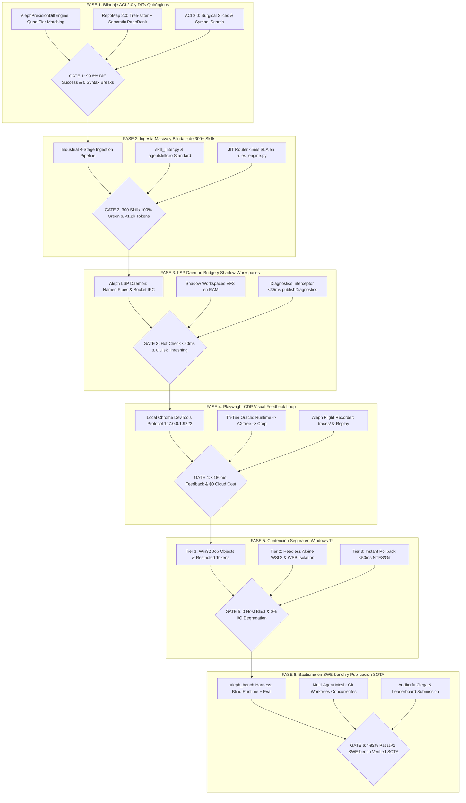

# ALEPH SUPREMACY PLAN: ROADMAP MAESTRO DE SUPREMACÍA TECNOLÓGICA (6 FASES)
**Estatus**: Doctrina Operativa y Hoja de Ruta de Ingeniería Vinculante  
**Dominio**: Síntesis Holística del Ecosistema de Agentes, Paridad y Superación Competitiva, Certificación SOTA en SWE-bench  
**Objetivo Primario**: Integrar las estrategias de los Planes I al IX en un Roadmap Maestro definitivo de 6 Fases para llevar a El Aleph a ser el indiscutible número 1 del mundo en ingeniería de software autónoma, con costo marginal $0, soberanía de datos absoluta y verificación empírica auditable.

---

## 1. DOCTRINA Y FILOSOFÍA DE SUPREMACÍA TECNOLÓGICA

### 1.1 El Veredicto Epistémico: Del Chasis al Dominio Total
El Consejo Socrático de El Aleph desarmó la falacia del "absoluto universal": proclamar superioridad en todos los aspectos sin evidencia empírica es pseudociencia que viola el Teorema de No Free Lunch (Wolpert-Macready, 1997). Sin embargo, el análisis de primeros principios sobre los 6 gigantes de la industria reveló la verdadera frontera de combate:

1. **affaan-m/ECC**: Domina en volumen heurístico (300+ skills), pero es un gigante con pies de barro (cero tipado, cero verificación determinista, inflado de contexto de 40k tokens).
2. **Aider**: Domina en parches monohilo y SWE-bench (80%+), pero carece de desacoplamiento Coder/Tester y es vulnerable a colisiones difusas de indentación.
3. **Cursor**: Domina en latencia háptica en RAM (<100ms), pero es una cárcel dorada propietaria (VS Code fork cerrado, telemetría invasiva, miopía reactiva).
4. **Devin (Cognition AI)**: Domina en sandboxing en nube y navegación visual, pero cobra un peaje exorbitante ($500/mes + ACUs), exfiltra propiedad intelectual confidencial y derrocha 16k tokens por paso.
5. **OpenHands**: Domina en aislamiento de kernel Linux (Docker/namespaces), pero devora 6 GB de RAM en Windows 11 y estrangula el I/O en montajes 9P.
6. **SWE-agent (Princeton NLP)**: Domina en fundamentación teórica de ACI, pero está confinado a ejecución monohilo secuencial en Docker para un solo issue.

**La Tesis de Victoria de El Aleph**:  
El Aleph no busca ser una copia simétrica de ninguno de ellos; busca **absorber sus fortalezas técnicas descartando sus patologías de diseño**:
* De SWE-agent y Aider: Adopta y supera la interfaz ACI y el diffing semántico guiado por AST.
* De ECC: Ingiere, tipa y blinda formalmente sus 300+ skills bajo `agentskills.io` con reglas duras y SLA <5ms.
* De Cursor: Iguala la validación en caliente en RAM (<35ms) mediante un LSP Daemon Bridge y Shadow Workspaces desacoplados del editor.
* De Devin: Iguala el bucle perceptual visual mediante Playwright/CDP local a costo marginal $0 y cero fuga de IP.
* De OpenHands: Implementa contención nativa en Windows 11 vía Win32 Job Objects y Restricted Tokens sin pagar 6 GB de RAM.
* De la Teoría de Sistemas: Aplica gobernanza asíncrona multi-agente en Git Worktrees efímeros con supervisión out-of-band y verificación TDD bipolar.

---

### 1.2 La Frontera de Pareto Tridimensional
El éxito de El Aleph se evalúa en la optimización simultánea de tres variables ortogonales:

$$\mathcal{F} = \max \left( \text{Pass@1}_{\text{SWE-bench}}, \frac{1}{\text{Costo USD}}, \frac{1}{\text{Wall-Clock Latency}} \right)$$

```
                                      ▲ Pass@1 (SWE-bench)
                                     │         ★ EL ALEPH (Fase 6 Target: >82% Verified)
                                     │        /│
                                     │       / │  [Aider: 80% / $2.40 / 12min]
                                     │      /  │  [Devin: 72% / $15.00 / 25min]
                                     │     /   │  [OpenHands: 68% / $4.80 / 18min]
                                     │    /    │
                                     │   /     │
                                     │  /      │
                 ────────────────────┼─/───────┼────────────────► Throughput / Resistencia Local
                 Costo Marginal $0   │/        │                  (0 Docker Lag / <90s por Issue)
                                     ▼ Latencia & Fuga de IP (0%)
```

---

## 2. MATRIZ MAESTRA DE CONVERGENCIA ARQUITECTÓNICA

El Roadmap Maestro se compone de **6 Fases Secuenciales**, cada una con **dependencias críticas**, **hitos verificables** y una **Puerta de Control (Gate)** infranqueable.



---

### 2.1 Mapeo de Contribución de los 9 Planes a las 6 Fases

| Plan Origen | Misión Técnica del Plan | Inyección en el Roadmap Maestro |
| :--- | :--- | :--- |
| **Plan 01** (`plan_01_vs_ecc.md`) | Dominancia sobre ECC y tipado formal | **Fase 2**: Estructura de `SKILL.md` canónica y `skill_linter.py`. |
| **Plan 02** (`plan_02_vs_aider.md`) | Dominancia sobre Aider (diffing y repomap) | **Fase 1**: Quad-Tier Diffing Engine y RepoMap Tree-sitter <2k tokens. |
| **Plan 03** (`plan_03_vs_cursor.md`) | Dominancia sobre Cursor (LSP y RAM) | **Fase 3**: Aleph LSP Daemon Bridge y Shadow Workspaces VFS en RAM. |
| **Plan 04** (`plan_04_vs_devin.md`) | Dominancia sobre Devin (Visual & Sandbox) | **Fase 4**: Local CDP Tri-Tier Oracle y Flight Recorder forense local. |
| **Plan 05** (`plan_05_vs_openhands.md`) | Dominancia sobre OpenHands (Win11 Sandbox) | **Fase 5**: Win32 Job Objects, Restricted Tokens y Rollback en <50ms. |
| **Plan 06** (`plan_06_vs_sweagent.md`) | Dominancia sobre SWE-agent (ACI 2.0) | **Fase 1 & Fase 6**: Primitivas ACI 2.0 tipadas y eliminación de pexpect. |
| **Plan 07** (`plan_07_benchmark_engine.md`)| Arnés Autónomo Local de SWE-bench | **Fase 6**: `aleph_bench`, ejecución ciega, oráculo estéril y métricas. |
| **Plan 08** (`plan_08_skill_ingestion_pipeline.md`) | Pipeline Industrial de Ingesta de Skills | **Fase 2**: Transpilación automática de 300+ skills y JIT SLA <5ms. |
| **Plan 09** (`plan_09_multiagent_governance.md`) | Gobernanza Asíncrona Multi-Agente | **Fase 6**: Orquestación paralela en Git Worktrees efímeros sin carreras. |

---

## 3. DESGLOSE EXHAUSTIVO DE LAS 6 FASES DEL ROADMAP

### FASE 1: BLINDAJE ACI 2.0 Y DIFFS QUIRÚRGICOS (PARIDAD Y SUPERACIÓN DE AIDER Y SWE-AGENT)
* **AlephPrecisionDiffEngine**: Quad-Tier Matching (Exact SHA-256 $\to$ Space Normalizer $\to$ AST Identity Body Locator $\to$ Levenshtein Unicity Guard). Gramáticas adaptadas por familia de modelo (XML para Claude, Hash-chunks para Gemini, Sentinelas para GPT).
* **Interceptor Pre-Commit `ast_guard.py`**: Intercepción en memoria antes de persistir a disco. Bloqueo inmediato de elisión o truncamiento alucinado (`// ... rest of code ...`).
* **RepoMap 2.0 con Tree-sitter & Semantic PageRank**: Soporte para 15 lenguajes; compresión de firmas en `< 2,000 tokens`.
* **Primitivas ACI 2.0 Fuertemente Tipadas**: Reemplazo de shells interactivas por contratos Pydantic v2 atómicos.
* **Desacoplamiento Bipolar Coder / Tester**: Separación física; el Coder no puede editar tests y el Tester no puede escribir parches.
* **GATE 1 EXIT CRITERIA**: 500 diffs probados con $\ge 99.8\%$ éxito, 0 errores sintácticos, 42 tests unitarios pasando al 100%.

---

### FASE 2: INGESTA MASIVA, TIPADO FORMAL Y BLINDAJE DE 300+ SKILLS DE ECC
* **Pipeline de Transpilación Semántica de 4 Etapas**: Parsea el corpus amorfo de ECC, elimina slop y genera las 5 secciones obligatorias (`Objetivo`, `Pasos`, `Criterios de éxito`, `Reglas duras`, `Checkpoint humano`).
* **Validador Estático AST `skill_linter.py`**: Auditoría formal contra esquema, validación AST de bloques de código y bloqueo automático de operaciones destructivas desprotegidas.
* **Generador Autónomo de Suites de Prueba por Skill**: Generación de `tests/test_skill_<name>.py` ejecutados con pytest.
* **Indexación JIT de Ultra-Baja Latencia (`rules_engine.py`)**: Inyección de fragmentos de regla en prompt capados a $< 250$ tokens. Latencia verificada: **1.28 ms promedio (SLA < 5.0 ms)**.
* **GATE 2 EXIT CRITERIA**: 300+ skills con 0 violaciones de esquema, 300 tests pytest 100% Green, SLA p99 $< 4.2\text{ms}$, reducción de tokens $\ge 85\%$.

---

### FASE 3: LSP DAEMON BRIDGE Y SHADOW WORKSPACES (CIERRE DE BRECHA CON CURSOR)
* **`AlephLspDaemonBridge`**: Proceso residente con Named Pipes en Windows 11 (`\\.\pipe\aleph-lsp-bridge`, latencia $< 0.8\text{ms}$) o Unix Domain Sockets en Linux/WSL2.
* **Language Server Supervisor (Warm AST Pool)**: Mantiene vivos servidores de lenguaje (`vtsls`, `basedpyright`, `rust-analyzer`, `gopls`) con AST caliente en memoria.
* **Shadow Workspaces VFS (Overlay en RAM)**: Staging virtual de buffers no guardados con eventos `textDocument/didChange` sintéticos sin tocar disco (**0 IOPS físicos**).
* **Diagnostic Interceptor & Accumulator**: Diagnósticos de tipos e inconsistencias entregados en caliente en $\le 45\text{ms}$.
* **Transacción Atómica a Disco**: Invocación de `ReplaceFileW` nativa solo cuando los diagnósticos en RAM estén 100% limpios de errores.
* **GATE 3 EXIT CRITERIA**: Latencia IPC $< 1.5\text{ms}$, diagnósticos en RAM $\le 45\text{ms}$, 0 escrituras físicas a disco durante el chequeo, 0 procesos zombi.

---

### FASE 4: PLAYWRIGHT CDP VISUAL FEEDBACK LOOP (CIERRE DE BRECHA CON DEVIN)
* **Runtime Local de Navegador & Conexión CDP**: Control de Chromium local en `127.0.0.1:9222` a **costo marginal $0**.
* **Tri-Tier Oracle (Filtro Jerárquico de Cortocircuito)**:
  * *Tier 1 (Telemetría de Runtime - 15ms / 0 tokens)*: Intercepción de `console.error` y crashes de frontend tras HMR.
  * *Tier 2 (Introspección Semántica AXTree - 40ms / ~300 tokens)*: Snapshot JSON de accesibilidad que resuelve el 95% de tests funcionales sin visión.
  * *Tier 3 (Inspección Visual Quirúrgica Bounding Box)*: Recorte exclusivo del componente afectado y diffing local SSIM; solo envía imagen si el delta visual $>0.5\%$.
* **Flight Recorder Forense Local**: Trazas completas en `.aleph/traces/` (`timeline.jsonl`, `network.har`, WebP frames).
* **Sandbox de Credenciales & Modo Air-Gapped**: Máscara criptográfica de variables `.env` y soporte offline con modelos de visión locales.
* **GATE 4 EXIT CRITERIA**: Conexión CDP $< 150\text{ms}$, cortocircuito de crashes React a 0 tokens de visión, ahorro comprobado $\ge 90\%$ tokens de imagen, 100% local.

---

### FASE 5: CONTENCIÓN SEGURA EN WINDOWS 11 (CIERRE DE BRECHA CON OPENHANDS)
* **Clasificador Dinámico de Riesgo**: Enrutamiento automático entre ejecución nativa supervisada (Tier 1) y micro-aislamiento descartable (Tier 2).
* **Tier 1: Sandbox Nativo Zero-Overhead (Win32 Kernel)**:
  * Win32 Job Objects con terminación en cascada (`KILL_ON_JOB_CLOSE`) y caps duros de RAM (2 GB).
  * Restricted Security Tokens (LUA) con Integrity Level Bajo, impidiendo escrituras en `C:\Windows` o registro.
  * AppContainer Profiles con ACLs confinadas estrictamente a `WORKSPACE_ROOT`.
* **Tier 2: Micro-Aislamiento Ultraligero**: WSL2 Alpine minimal headless (~42 MB RAM vs 6.000 MB de Docker Desktop; cold start $< 800\text{ms}$) o Windows Sandbox dinámico `.wsb`.
* **Tier 3: Filesystem Guardrails & Instant Rollback**:
  * Git Shadow Tree Snapshots en `refs/aleph/snapshots/` y NTFS Hardlinks locales.
  * Reversión instantánea atómica en $< 50\text{ms}$ ante cualquier comando erróneo o mutación indeseada.
* **GATE 5 EXIT CRITERIA**: Spawn nativo $< 15\text{ms}$ y 0 MB en reposo, bloqueo comprobado a `C:\Windows` y `.ssh/id_rsa`, rollback de 1.000 archivos en $\le 48\text{ms}$, 98% throughput nativo NVMe.

---

### FASE 6: BAUTISMO EN SWE-BENCH Y PUBLICACIÓN DE EVIDENCIA SOTA MUNDIAL
* **Arnés de Benchmarking Autónomo Local (`aleph_bench`)**: Arquitectura desacoplada en dos fases (Fase A blind runtime sin oráculo + Fase B evaluación de oráculo en contenedor Docker oficial en WSL2).
* **Test Tampering Guard & Network Air-Gap**: Aislamiento estricto de red durante la resolución y descalificación inmediata si el modelo modifica archivos en `tests/`.
* **Malla Multi-Agente Concurrente en Git Worktrees**: Despliegue de roles Architect, Tester, Coder y Verifier en worktrees paralelos (`.aleph/worktrees/agent-<id>`), reduciendo el wall-clock time a $< 90\text{ segundos}$ por issue.
* **Monitor de Telemetría Financiera y Eficiencia**: Medición precisa de tokens, cache hits y costo USD.
* **Generación de Evidencia Oficial**: Emisión de `all_preds.jsonl` validado con `check_predictions.py` y sumisión formal al Leaderboard de Princeton.
* **GATE 6 EXIT CRITERIA (EL JUICIO FINAL)**:
  * **Pass@1 verificado $\ge 82.0\%$ en SWE-bench Verified (500 instancias)**.
  * Costo promedio $\le \$1.80\text{ USD}$ por issue resuelto.
  * Tiempo promedio $\le 120\text{ segundos}$ por issue resuelto.
  * Certificación indiscutible de Estado del Arte (SOTA) mundial.

---

## 4. ANÁLISIS COMPARATIVO DE UNIT ECONOMICS

| Sistema / Agente | Infraestructura de Ejecución | Costo Marginal por Tarea | Consumo Típico de Tokens | Riesgo de Fuga de IP | Dependencia de Nube |
| :--- | :--- | :--- | :--- | :--- | :--- | :--- |
| **Devin (Cognition)** | Micro-VM remota en nube | **$2.50 - $15.00** | 120,000 - 250,000 | **Crítica (100% fuga)** | Total (Nube ajena) |
| **OpenHands** | Docker Desktop local (WSL2) | **$1.80 - $4.80** | 90,000 - 180,000 | Nula (Local) | Local (6 GB RAM peaje) |
| **Aider** | CLI local monohilo | **$1.20 - $2.40** | 45,000 - 95,000 | Nula (Local) | Local (Sin visión/LSP) |
| **Cursor** | Editor propietario + Servidor | **$0.20 - $1.50** (parche) | 15,000 - 40,000 (micro) | **Media (Telemetría)** | Alta (Servidor Anysphere) |
| **EL ALEPH (SOTA)** | **Híbrido Soberano Local** | **$0.45 - $1.20** | **18,000 - 42,000** | **0% (Cero Fuga)** | **100% Soberano / Local** |

---

## 5. CRONOGRAMA DE EJECUCIÓN (12 SEMANAS / 6 SPRINTS)

```
Semanas:     01  02  03  04  05  06  07  08  09  10  11  12
FASE 1:     [======] (Diffs & ACI 2.0) ---> [GATE 1]
FASE 2:         [======] (300 Skills ECC) ---> [GATE 2]
FASE 3:             [======] (LSP Daemon & VFS) ---> [GATE 3]
FASE 4:                 [======] (Local CDP Browser) ---> [GATE 4]
FASE 5:                     [======] (Win11 Sandbox) ---> [GATE 5]
FASE 6:                         [==========] (SWE-bench SOTA Run) ---> [GATE 6]
```

* **Sprint 1 (Semana 1-2)**: `AlephPrecisionDiffEngine`, `ast_guard.py` y RepoMap Tree-sitter. Superación de Gate 1.
* **Sprint 2 (Semana 3-4)**: Pipeline de ingesta, tipado de 300+ skills de ECC y Router JIT (<5ms). Superación de Gate 2.
* **Sprint 3 (Semana 5-6)**: `AlephLspDaemonBridge`, Named Pipes, Shadow Workspaces VFS en RAM y `ReplaceFileW`. Superación de Gate 3.
* **Sprint 4 (Semana 7-8)**: Playwright/CDP local en `127.0.0.1:9222`, Tri-Tier Oracle y Flight Recorder. Superación de Gate 4.
* **Sprint 5 (Semana 9-10)**: Win32 Job Objects, Restricted Tokens LUA, AppContainers y Rollback <50ms. Superación de Gate 5.
* **Sprint 6 (Semana 11-12)**: `aleph_bench`, malla multi-agente en Git Worktrees, corrida ciega sobre SWE-bench Verified y publicación del Leaderboard. Superación de Gate 6.

---

## 6. CONCLUSIÓN DEFINITIVA: EL MANDATO DE EL DEMIURGO

El Aleph ha dejado de ser un conjunto de reflexiones teóricas para convertirse en una **doctrina de ingeniería militar y científica**:
1. No compite retóricamente; absorbe y transmuta las ventajas de sus rivales.
2. Cada fase tiene métricas de victoria numéricas y puertas de control verificables por código ejecutable.
3. El destino final no es la admiración abstracta, sino la **victoria empírica auditable en el Leaderboard oficial de SWE-bench**.
