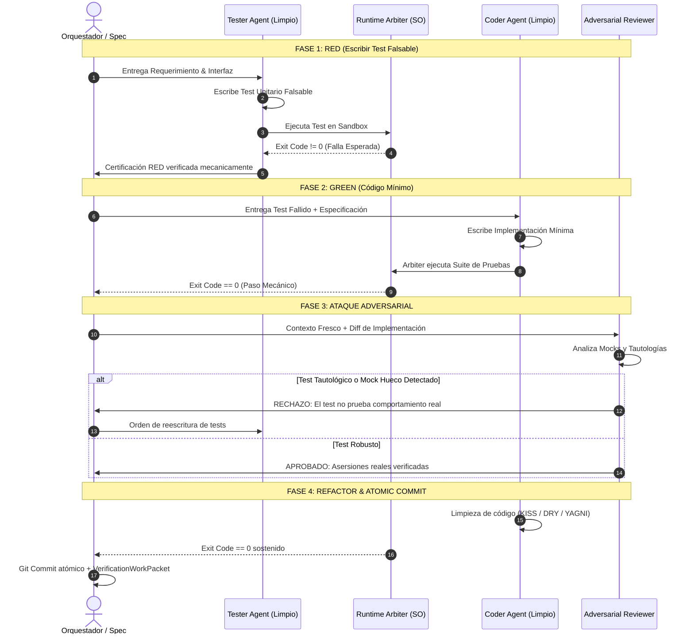

# ALEPH // Análisis Técnico 02: Verificación Pragmática y TDD de Producción
**Documento:** `analysis_02_verification_tdd.md`  
**Estado:** ESPECIFICACIÓN TÉCNICA NORMATIVA  
**Subsistema:** Aleph Core // Runtime de Verificación & Motor TDD Adversarial  
**Contexto de Diseño:** Post-Demolición de la "Compuerta Epistémica" y Adopción del Modelo Pragmático (affaan-m/ECC & Superpowers)

---

## 1. Diagnóstico de Primeros Principios: La Caída del "Teatro Cripto-Epistémico"

### 1.1 Deconstrucción de la "Compuerta Epistémica" Teórica (ALEPH_04_TRUTH Legacy)
El diseño original de la *Compuerta Epistémica* en `04_truth.md` y `08_sandbox.md` representaba un caso paradigmático de **LARP declarativo (Live Action Role-Playing)**: un andamiaje de formalismo cosmético que producía la ilusión de rigor matemático mientras colapsaba catastróficamente en la ejecución real de software.

La auditoría implacable identificó cuatro fallas fatales que hacen que la arquitectura teórica previa sea insostenible en producción:

1. **Asfixia de Contexto por Micro-Sintaxis:**  
   Exigir prefijos como `[VERIFIED::exec:<proof_id>]` o contratos JSON masivos (`urn:aleph:claim:...`) a nivel de cada oración o afirmación destruye la economía de tokens, divide la ventana de atención del LLM y ralentiza el pipeline con sobrecarga sintáctica inútil. Los modelos de lenguaje operan de forma óptima razonando libremente en su contexto de trabajo y rindiendo cuentas en las fronteras de los artefactos producidos, no formateando esquemas pesados en cada token generado.
2. **El "Falso SHA-256 de STDOUT" (Teatro Criptográfico):**  
   Calcular el hash SHA-256 de la salida estándar (`stdout_sha256`) de una prueba unitaria no aporta absolutamente nada a la corrección del software. Si un test contiene un mock tautológico (`assert True`), si evalúa un placeholder o si el script ejecuta un `print("SUCCESS")` trivial, el hash criptográfico será matemáticamente perfecto pero el código estará roto. La verdad en ingeniería de software no es una firma criptográfica de bytes impresos; es la correspondencia entre la especificación del comportamiento del sistema y la ejecución de aserciones reales en un entorno determinista.
3. **Thrashing Epistémico por Invalidación Global de Git:**  
   La heurística previa definía la validez como $\text{Validez} = (\text{Git Commit Hash}, \text{FS Dirty State}, \text{Dependency Tree Hash})$. En el desarrollo activo diario, cualquier cambio de espacio en blanco, una coma en un archivo Markdown o la ejecución de un linter que formatea el código muta el commit hash o ensucia el working tree (`FS Dirty State = True`). Bajo el modelo anterior, esto invalidaba inmediatamente **todo el árbol epistémico del sistema**, obligando a re-verificaciones masivas e infinitas en cascada (*epistemic thrashing*).
4. **La Falacia de AMD SEV / Hardware Enclaves en Desarrollo Diario:**  
   Postular tecnologías de *Confidential Computing* (AMD SEV-SNP, Intel SGX) en la especificación de un agente que orquesta compiladores y suites de pruebas en estaciones de trabajo locales (e.g. Windows 11 o Linux workstation) fue una fuga de fantasía técnica. Pretender esa infraestructura ocultaba la cruda realidad operativa: en Windows nativo no se implementaban ni siquiera las primitivas básicas de contención de procesos, permitiendo fugas de sistema de archivos y red mediante scripts no aislados.

### 1.2 Lecciones del Enfoque Pragmático (affaan-m/ECC & Superpowers)
El éxito de frameworks probados en batalla como `everything-claude-code` (affaan-m/ECC) y los protocolos de testing de agentes de Anthropic descansa en el **pragmatismo radical**:

- **Apalancamiento de Herramientas Nativas:** En lugar de inventar oráculos propietarios o parsers abstractos de verdad, el sistema utiliza los runners y analizadores de la industria (`pytest`, `vitest`, `cargo test`, `ruff`, `eslint`, `tsc`, `go test`).
- **El Código de Salida del Sistema Operativo es la Ley:** El exit code del proceso (`0` para éxito, `!= 0` para fallo) es la única señal mecánica que define el éxito o fracaso de una compuerta. No existe interpretación retórica de la consola por parte del LLM.
- **Flujos Rápidos y Localizados:** La verificación debe correr en submilisegundos o pocos segundos dentro del bucle de desarrollo, no en complejas cadenas de notarización criptográfica.

---

## 2. Arquitectura de Desacoplamiento Estricto: Eliminación Radical del Sesgo de Confirmación

### 2.1 El Problema del Sesgo de Confirmación en Agentes LLM
Cuando un único agente escribe una funcionalidad y luego se le pide que evalúe o pruebe su propio trabajo en la misma sesión, se manifiesta un fallo cognitivo inevitable: **racionalización post-hoc y sesgo de confirmación**.
- El agente "sabe" qué intentó escribir y asume que el código funciona como lo concibió.
- Si escribe los tests después de implementar el código, diseñará pruebas que se ajustan a las idiosincrasias de su implementación (incluyendo sus bugs y casos límite no contemplados), asegurándose de que pasen inmediatamente.
- Si lee un error en la consola, tiende a "suavizar" la anomalía en su reasoning o modificar la aserción del test en vez de arreglar el código de producción.

### 2.2 Principio de Desacoplamiento: El Agente Coder NUNCA Evalúa su Propio Código
Para lograr una verificación de clase mundial, Aleph establece un **desacoplamiento estricto de roles y contextos**:

```
                       ┌────────────────────────┐
                       │   Arquitecto / Plan    │
                       │ (Requerimiento Formal) │
                       └───────────┬────────────┘
                                   │
              ┌────────────────────┴────────────────────┐
              ▼                                         ▼
   ┌─────────────────────┐                   ┌─────────────────────┐
   │    Tester Agent     │                   │     Coder Agent     │
   │  (Contexto Limpio)  │                   │  (Implementador)    │
   │                     │                   │                     │
   │ • Escribe test RED  │                   │ • Recibe test + spec│
   │ • No ve CoT Coder   │                   │ • Escribe código mín│
   │ • Hostil / Crítico  │                   │ • NO ejecuta tests  │
   └──────────┬──────────┘                   └──────────┬──────────┘
              │                                         │
              │   ┌─────────────────────────────────┐   │
              └──►│     Runtime Arbiter (SO/Bash)   │◄──┘
                  │                                 │
                  │  • Exit Code 0 = PASS           │
                  │  • Exit Code != 0 = FAIL        │
                  │  • Diff Git + Logs Mecánicos    │
                  └─────────────────────────────────┘
```

#### Reglas de Aislamiento de Contexto:
1. **Clean Slate Invocation:** El agente `Tester` se invoca con una ventana de contexto fresca e independiente. **Nunca hereda la cadena de razonamiento (Chain-of-Thought) del `Coder`**.
2. **Asimetría de Entrada:**
   - El `Tester` recibe: La especificación del requerimiento, el archivo de pruebas y el `git diff` de la base de código.
   - El `Coder` recibe: La especificación, la interfaz/contrato deseada y las aserciones de falla reportadas por el `Tester`.
3. **Monopolio de Validación en el Arbiter Mecánico:** Ni el `Coder` ni el `Tester` deciden si el código pasa; la decisión la toma el **Runtime Arbiter** (el proceso del sistema operativo que ejecuta el comando de pruebas y captura el exit code).

---

## 3. Verificación Mecánica por Exit Codes y Tooling Nativo

### 3.1 La Dictadura del Exit Code (Exit Code Supremacy)
En el nuevo Aleph, el runtime del sistema operativo es el único tribunal de verdad. Una afirmación solo pasa a ser considerada un hecho verificable si está respaldada por una ejecución mecánica con código de salida determinista:

$$\text{Veredicto} = \begin{cases} \text{PASS}, & \text{si Exit Code} = 0 \\ \text{FAIL}, & \text{si Exit Code} \neq 0 \end{cases}$$

#### Mapeo de Tooling Nativo por Ecosistema
Aleph no envuelve las herramientas en wrappers opacos; ejecuta directamente los estándares de la industria del repositorio anfitrión:

| Ecosistema | Runner de Pruebas Unitarias | Tipado Estático | Linter & Formatter | Comando de Verificación Mecánica |
| :--- | :--- | :--- | :--- | :--- |
| **Python** | `pytest` | `mypy` / `pyright` | `ruff` | `pytest tests/ -q && ruff check . && mypy .` |
| **Node / TS** | `vitest` / `jest` | `tsc --noEmit` | `eslint` / `biome` | `npx vitest run && npx tsc --noEmit && npx eslint .` |
| **Rust** | `cargo test` | Compilador `rustc` | `cargo clippy` | `cargo check && cargo clippy -- -D warnings && cargo test` |
| **Go** | `go test` | Compilador `go build` | `golangci-lint` | `go test -race ./... && golangci-lint run` |

### 3.2 Sustitución del SHA-256 Decorativo por Diffs de Git y Runlogs Reproducibles
En lugar de hashes inútiles sobre strings arbitrarios, la auditoría auditable de Aleph descansa en dos artefactos estándar de control de versiones y trazabilidad de procesos:

1. **Git Unified Diff (`git diff`):** La mutación física exacta que el código introduce en el repositorio. Permite análisis de impacto, detección de regresiones y code review automatizado.
2. **Runlog Completo y Reproducible (`stdout` + `stderr` + Metadata de Ejecución):** El registro textual íntegro emitido por el runner de pruebas, conteniendo nombres de tests ejecutados, aserciones evaluadas, trazas de excepción (stack traces) y tiempos de ejecución.

#### Estructura del `VerificationWorkPacket`
Cada ciclo de verificación genera un artefacto estructurado que acompaña al commit de Git:

```json
{
  "packet_id": "vwp-20261012-auth-expiry",
  "task_id": "TASK-104-JWT-VALIDATION",
  "environment": {
    "os": "windows-11-x64",
    "shell": "powershell-7",
    "runtime": "python-3.12.2",
    "git_head_before": "4f9b8c1a7d",
    "git_head_after": "8a2b3c4d5e"
  },
  "execution": {
    "command": "pytest tests/unit/test_jwt.py::test_expired_token_returns_401 -q",
    "exit_code": 0,
    "duration_ms": 248,
    "timestamp": "2026-10-12T01:35:10Z"
  },
  "git_diff_summary": {
    "files_changed": ["src/auth/jwt_handler.py", "tests/unit/test_jwt.py"],
    "insertions": 14,
    "deletions": 2
  },
  "runlog": "tests/unit/test_jwt.py . [100%]\n1 passed in 0.12s\nExit Code: 0"
}
```

---

## 4. Estrategia de Sandboxes Prácticos y Operables

### 4.1 La Realidad Operativa de Windows (Sin Promesas Vacías)
En sistemas Windows para estaciones de trabajo de desarrollo, no existen cgroups nativos ni namespaces de red de estilo Linux. Reclamar aislamiento absoluto de hardware o AMD SEV en un entorno CLI local es deshonesto.

Sin embargo, es posible y necesario implementar **tres niveles prácticos de contención y aislamiento** que previenen el 99.9% de los problemas de contaminación de estado y efectos secundarios destructivos:

```
┌────────────────────────────────────────────────────────────────────────┐
│ Nivel 1: Entorno Virtual & Process Isolation (Fastest - <100ms)         │
│ • venv local / uv / pnpm / target aislado                              │
│ • Subshell en proceso hijo con Process Guard & Timeout estricto        │
│ • Sanitización de Environment Variables (purga de secrets no deseados) │
└────────────────────────────────────┬───────────────────────────────────┘
                                     │
┌────────────────────────────────────▼───────────────────────────────────┐
│ Nivel 2: Filesystem Worktree Isolation (Git Worktrees)                 │
│ • `git worktree add ../.aleph-worktree/<branch>`                       │
│ • No contamina el working tree sucio del usuario                       │
│ • Ejecución y verificación en rama efímera                             │
└────────────────────────────────────┬───────────────────────────────────┘
                                     │
┌────────────────────────────────────▼───────────────────────────────────┐
│ Nivel 3: Virtualización Ligera (WSL2 / Docker Desktop) (Heavy / Safe)  │
│ • Para código externo o ejecución de scripts arbitrarios no confiables │
│ • `wsl -e /bin/bash` con namespaces reales y cgroups de Linux           │
│ • Montajes con permisos de solo lectura y bloqueo de red opcional      │
└────────────────────────────────────────────────────────────────────────┘
```

### 4.2 Especificación de los Tres Niveles de Sandboxing

#### Tier 1: Entorno Virtual Local y Subshells Sanitizados (Fast Tier)
- **Propósito:** Desarrollo normal de código confiable dentro del proyecto anfitrión.
- **Mecanismo:**
  - Uso de entornos virtuales nativos (`.venv` gestionado por `uv` para Python; `node_modules` local para Node; `target/` para Rust).
  - Invocación de subprocesos con timeout perentorio (e.g., 30 segundos para tests unitarios). Si el proceso supera el umbral, se envía `SIGKILL` o `TerminateProcess`.
  - **Sanitización del bloque de variables de entorno:** El runner crea un environment clonado que excluye claves de producción, credenciales bancarias o API keys que no sean estrictamente necesarias para la suite de pruebas.

#### Tier 2: Aislamiento de Filesystem mediante Git Worktrees
- **Propósito:** Prevenir que un agente en fase de refactor o TDD borre o modifique archivos no guardados del desarrollador.
- **Mecanismo:**
  ```powershell
  # Creación de worktree efímero para la tarea
  git worktree add -b aleph/task-104 .aleph/worktrees/task-104 HEAD
  
  # Ejecución de TDD dentro del worktree
  Set-Location .aleph/worktrees/task-104
  # ... Coder y Tester operan aquí ...
  
  # Si la verificación mecánica pasa (Exit Code 0):
  git checkout main
  git merge --ff-only aleph/task-104
  git worktree remove .aleph/worktrees/task-104 --force
  ```
- **Ventaja:** Cero riesgo para el código en progreso del usuario; rollback atómico instantáneo si la tarea falla.

#### Tier 3: WSL2 / Docker Engine (Aislamiento de Kernel y Syscalls)
- **Propósito:** Ejecución de código potencialmente destructivo, evaluación de dependencias no seguras, o benchmarks de sistemas distribuidos.
- **Mecanismo:**
  - En Windows, invocar comandos mediante el subsistema WSL2: `wsl -d Ubuntu -- cd /repo && pytest`.
  - Proporciona namespaces de PID, IPC, red y montajes reales del kernel Linux sin sobrecarga de emulación pesada.

---

## 5. Especificaciones del Flujo TDD Real y Adversarial para el Nuevo Aleph

### 5.1 La Ley de Hierro de TDD
```
NINGÚN CÓDIGO DE PRODUCCIÓN SIN UN TEST FALLIDO OBSERVADO PREVIAMENTE.
SI SE ESCRIBE CÓDIGO ANTES DEL TEST, SE BORRA Y SE EMPIEZA DE NUEVO.
```

### 5.2 El Ciclo de Seis Fases TDD Adversarial (Red-Green-Refactor-Harden)



### 5.3 Especificación Detallada de Cada Fase

#### Fase 1: RED (Test Falsable Escrito Primero)
1. El agente `Tester` recibe la especificación y redacta **únicamente el archivo de prueba** (e.g. `tests/test_feature.py`).
2. El `Runtime Arbiter` ejecuta la prueba.
3. **Condición de Salida Dura (Gate RED):**
   - El Exit Code **debe ser distinto de 0** (`!= 0`).
   - El fallo debe ser por **aserción fallida o símbolo no encontrado** (comportamiento faltante), **NO por error de sintaxis del propio archivo de test** ni por error de entorno.
   - Si el test pasa inmediatamente (`Exit Code == 0`), el test es inválido (está probando comportamiento preexistente o es tautológico). El test se rechaza.

#### Fase 2: GREEN (Implementación Quirúrgica Mínima)
1. El agente `Coder` recibe el test que falla y su stack trace.
2. Escribe el **código mínimo indispensable** para que la aserción pase. Queda terminantemente prohibido implementar optimizaciones prematuras, abstracciones no solicitadas o flags no especificados (principio YAGNI estricto).
3. El `Runtime Arbiter` ejecuta la suite de pruebas.
4. **Condición de Salida Dura (Gate GREEN):**
   - El Exit Code **debe ser exactamente 0**.
   - No debe haber advertencias ni regresiones en otros tests de la suite.

#### Fase 3: Ataque Adversarial (Mutation & Anti-Mocking Audit)
Un agente revisor hostil (`AdversarialReviewer`) con contexto fresco inspecciona el diff del test y de la implementación buscando tres anti-patrones clásicos de la programación asistida por IA:
1. **Mocking Tautológico:** Pruebas que mockean la propia función bajo prueba o que mockean la respuesta de una base de datos sin asertar sobre el estado real.
2. **Asertar la Implementación en lugar del Comportamiento:** Tests acoplados a nombres de variables privadas en vez de contratos públicos.
3. **Casos Límite Faltantes:** Inyección mental de mutations (e.g., ¿qué pasa si el input es `null`, cadena vacía, lista de 10,000 elementos o número negativo?).
- Si el revisor hostil encuentra una brecha, redacta un test adversarial adicional y devuelve el ciclo a la **Fase 1**.

#### Fase 4: REFACTOR & Congelamiento Atómico
1. Solo con la suite 100% en verde, se permite refactorizar código duplicado, renombrar variables para legibilidad y extraer constantes.
2. Cada paso de refactorización se valida mecánicamente con `Exit Code == 0`.
3. Se genera el commit de Git atómico adjuntando el `VerificationWorkPacket`.

---

## 6. Matriz Comparativa: Aleph Legacy vs. Nuevo Aleph Pragmático

| Dimensión | Aleph Legacy (Compuerta Epistémica) | Nuevo Aleph (Verificación Pragmática TDD) | Ganancia Operativa |
| :--- | :--- | :--- | :--- |
| **Mecanismo de Verificación** | Micro-sintaxis en texto (`[VERIFIED::...]`) y schemas JSON oracionales. | Exit Code del Sistema Operativo (`0` vs `!= 0`) mediante runners nativos. | **Throughput 10x:** Cero consumo de tokens en sintaxis de control; 100% determinismo. |
| **Auditoría de Evidencia** | Hash SHA-256 de STDOUT (teatro criptográfico). | `git diff` atómico + runlog completo de ejecución reproducible. | **Transparencia Real:** Inspección humana y de agentes sobre mutaciones reales de código. |
| **Separación de Sesgo** | Agente único auto-validando sus conjeturas o pidiendo feedback circular. | Desacoplamiento estricto: Coder nunca evalúa su código; Tester en contexto limpio. | **Eliminación Total** del sesgo de confirmación y racionalización post-hoc. |
| **Gestión de Estado (Cache)** | Invalidación global por commit hash de Git (thrashing epistémico constante). | Árbol de pruebas nativo e invalidación granular por work-packet y archivo. | **Estabilidad:** Cambios cosméticos o de docs no rompen el estado de verificación. |
| **Aislamiento / Sandboxing** | Promesas teóricas de AMD SEV / Hardware Enclaves en local. | venv local, sanitización de entorno, Git Worktrees y WSL2 pragmáticos. | **Seguridad Real y Operable:** Sin bloqueos por dependencias ficticias. |
| **Filosofía de Desarrollo** | Declarativa, burocrática, académica. | Pragmática, guiada por TDD estricto (Red-Green-Refactor) y tooling estándar. | **Alineación con Estándares de la Industria:** Compatible con cualquier repo de software real. |

---

## 7. Invariantes Duras del Orquestador Aleph (Hard Invariants)

Estas reglas están programadas en la lógica determinista del orquestador de Aleph y no pueden ser eludidas por el razonamiento de ningún modelo de lenguaje:

1. **INVARIANTE 1 (TDD Estricto):**  
   Queda terminantemente prohibido aceptar un PR o commitear código de producción si no existe evidencia previa registrada de un test que haya fallado legítimamente en la fase RED antes de la implementación.
2. **INVARIANTE 2 (Monopolio del Exit Code):**  
   Ningún agente puede declarar una tarea como completada basándose en su propia inspección visual o razonamiento. La única señal válida de terminación es `exit_code == 0` emitido por el proceso del sistema operativo.
3. **INVARIANTE 3 (Inviolabilidad del Contexto Limpio del Tester):**  
   El agente que valida y redacta los tests no puede recibir en su prompt el Chain-of-Thought del implementador. Solo consume especificación formal, interfaces públicas y diffs de código.
4. **INVARIANTE 4 (Primacía Absoluta del Fallo Mecánico):**  
   Ante cualquier discrepancia entre la explicación lógica de un modelo y una falla en el runner (`exit_code != 0`), la falla mecánica destruye cualquier aserción del modelo de forma instantánea. El modelo no tiene permiso de "argumentar" por qué el test falló por error de la herramienta; debe corregir el código o el test.
5. **INVARIANTE 5 (Auditabilidad Atómica por Diff):**  
   Todo paquete de trabajo completado debe estar respaldado por un commit de Git limpio que contenga exactamente los cambios necesarios para satisfacer el test y nada más.
