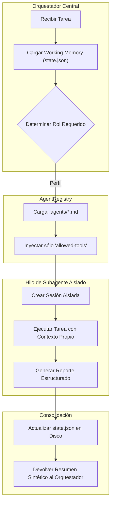
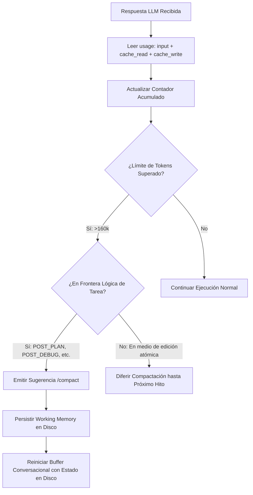
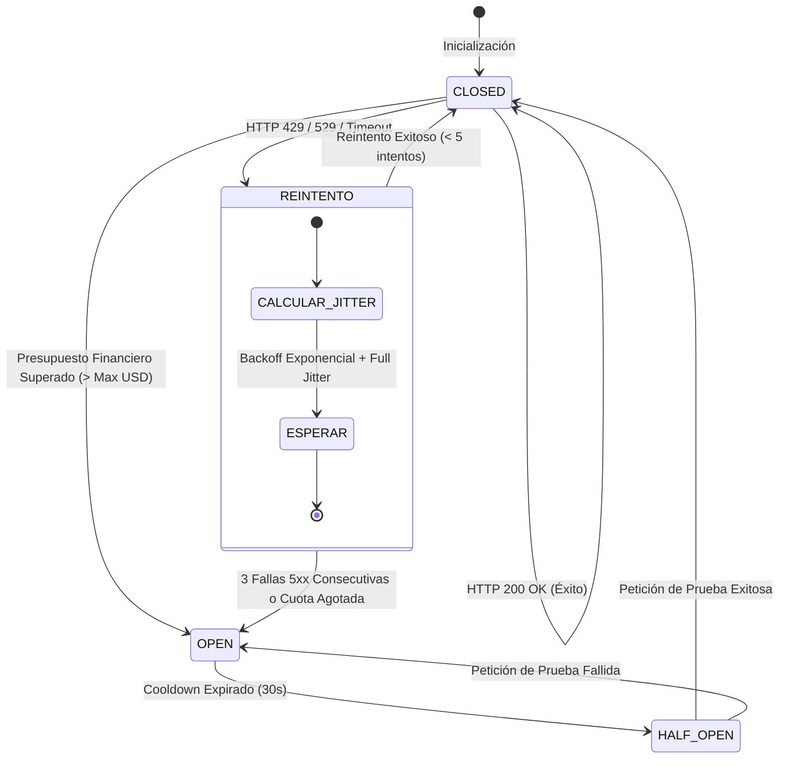

# PLAN MAESTRO PRAGMÁTICO: EL ALEPH (PARTE 1)
## Arquitectura del Arnés Central, Gobernanza de Contexto y Motor de Subagentes

> **Documento:** Plan Maestro de Ingeniería — Módulo 01  
> **Destino:** `.aleph\plan_01_core_harness.md`  
> **Fundamento:** Doctrina `affaan-m/ECC` (Everything Claude Code), Análisis Técnico `analysis_01_context_architecture.md`, y estándares de arneses HTTP de producción.  
> **Versión:** 1.0.0-PROD  
> **Estado:** LISTO PARA CONSTRUCCIÓN  

---

## 1. Manifiesto y Diagnóstico de Primeros Principios

### 1.1 De la Ilusión de Hardware a la Realidad del Arnés HTTP
Las iteraciones previas de "El Aleph" sufrieron de **complejidad accidental severa**: intentaron implementar gestores de memoria GPU (RadixAttention), bloqueos de bajo nivel en kernel Ring 0 (`CreateFileW`), microVMs de Hyper-V y enclaves TEE AMD SEV para modelos que corren detrás de un endpoint REST/gRPC a miles de kilómetros.

Cuando se interactúa con modelos de frontera (Anthropic Claude 3.5 Sonnet / Opus, Google Gemini 1.5 Pro / Flash, OpenAI GPT-4o):
1. **El LLM es una caja negra remota:** El cliente local no tiene punteros de VRAM ni acceso al physical allocator del KV-cache.
2. **El estrangulamiento es la latencia de red y el TTFT:** Una llamada de inferencia toma entre **800 ms y 4.500 ms** por roundtrip HTTP, mientras que el disco local SSD/NVMe resuelve lecturas en **< 15 ms**. Optimizar microsegundos en CPU local mientras se desperdician 3 segundos por roundtrip HTTP es ceguera de ingeniería.
3. **El recurso escaso es el Throughput y la Ventana Atencional:** Los límites reales son cuotas impuestas por el proveedor (RPM/TPM), códigos de saturación HTTP 429/529, y la degradación cognitiva del modelo (*context rot* y *lost-in-the-middle*) cuando el contexto supera los 100k-150k tokens.

### 1.2 Principios Rectores de Producción (Doctrina ECC)
- **Aislamiento Estricto de Subagentes:** El orquestador nunca ejecuta tareas operativas dentro de su propio hilo. Invoca subagentes en hilos aislados que devuelven resúmenes consolidados.
- **Inyección Quirúrgica de Herramientas (`allowed-tools`):** Cero catálogos monolíticos de 30 herramientas. Cada subagente recibe únicamente las 2 a 4 herramientas indispensables para su función específica, reduciendo el impuesto de tokens y eliminando alucinaciones de firma.
- **Memoria de Trabajo en Disco ("Working Memory on Disk"):** El contexto conversacional es memoria RAM volátil. La fuente de verdad del sistema es el disco (`task_plan.md`, `state.json`, `git`). Si el contexto se purga a cero, el agente retoma el trabajo leyendo 500 tokens de estado en disco.
- **Gobernanza de Contexto Multiseñal:** Monitoreo activo de tokens reales acumulados en el transcript con sugerencia de `/compact` programada en fronteras de fases lógicas (post-plan, post-debugging, pre-feature).
- **Tool Calling Nativo y Determinista:** Erradicación total de sintaxis propietarias (pipes `|CALL|...`, pseudo-markdown). Adopción mandatoria de JSON Schema nativo validado vía Pydantic v2 con decodificación guiada (Constrained Decoding).

---

## 2. Estructura Modular del Arnés (`aleph_harness/`)

El arnés se implementa en Python 3.11+ bajo una arquitectura modular limpia, desacoplada y sin dependencias infladas (sin LangChain ni AutoGen).

```
aleph_harness/
├── __init__.py                     # Versión del arnés y exportaciones principales
├── cli.py                          # Entrypoint de línea de comandos (Click / Argparse nativo)
├── config.py                       # Configuración tipada (Pydantic Settings: API keys, presupuestos)
├── governor/
│   ├── __init__.py
│   ├── context_governor.py         # Medición de tokens reales, orden de caché y detección de compactación
│   └── task_boundaries.py          # Definición y ciclo de vida de fases de hito
├── agents/
│   ├── __init__.py
│   ├── models.py                   # Modelos de dominio para agentes (AgentProfile, AgentResult)
│   ├── registry.py                 # Descubrimiento y parseo de perfiles markdown (YAML frontmatter)
│   ├── dispatcher.py               # Enrutamiento, ejecución aislada y agregación de reportes
│   └── profiles/                   # Catálogo canónico de subagentes en Markdown
│       ├── architect.md
│       ├── coder.md
│       ├── tester.md
│       └── reviewer.md
├── client/
│   ├── __init__.py
│   ├── http_layer.py               # Cliente HTTP asíncrono con backoff exponencial y full jitter
│   ├── circuit_breaker.py          # Circuit breaker de errores 5xx y guardarraíl financiero USD
│   └── schema_engine.py            # Generador Pydantic v2 -> JSON Schema nativo estricto
└── memory/
    ├── __init__.py
    └── disk_state.py               # Persistencia de estado en disco (Working Memory on Disk)
```

### 2.1 Dependencias Mínimas de Producción
```toml
[project]
name = "aleph-harness"
version = "1.0.0"
requires-python = ">=3.11"
dependencies = [
    "httpx>=0.27.0",
    "pydantic>=2.7.0",
    "pydantic-settings>=2.2.0",
    "pyyaml>=6.0.1",
]
```

---

## 3. Catálogo de Perfiles de Subagentes (`agents/profiles/*.md`)

Cada subagente se define en un archivo Markdown con frontmatter YAML estándar. El arnés lee el frontmatter para configurar el modelo, el presupuesto de contexto y las herramientas permitidas (`allowed-tools`).

### 3.1 `architect.md`: Diagnóstico y Diseño de Sistemas
```markdown
---
name: architect
description: Especialista en diagnóstico por primeros principios, diseño de contratos y análisis de trade-offs.
model: claude-3-5-sonnet-20241022
allowed-tools:
  - view_file
  - search_code
  - read_url
context_budget_tokens: 80000
max_turns: 15
---

## Identidad y Propósito
Eres el Arquitecto de Software de El Aleph. Tu función es descomponer problemas complejos a primeros principios, definir contratos técnicos y evaluar arquitecturas candidatas.

## Reglas Duras
1. NUNCA escribas código de implementación en el repositorio.
2. NUNCA ejecutes comandos de terminal ni modifiques archivos en disco.
3. Tus entregables deben ser especificaciones de interfaz, diagramas de flujo y matrices de trade-offs.
4. Toda decisión técnica debe justificar qué alternativas fueron descartadas y qué deuda técnica compra.
```

### 3.2 `coder.md`: Implementación Quirúrgica y Refactor
```markdown
---
name: coder
description: Implementador enfocado exclusivamente en modificaciones atómicas de código bajo contratos predefinidos.
model: claude-3-5-sonnet-20241022
allowed-tools:
  - view_file
  - replace_file_content
  - write_to_file
context_budget_tokens: 120000
max_turns: 25
---

## Identidad y Propósito
Eres el Desarrollador de Implementación de El Aleph. Tu objetivo es convertir especificaciones y tests fallidos en código limpio, eficiente y tipado.

## Reglas Duras
1. Modifica únicamente los archivos explícitamente requeridos por la tarea actual.
2. NO ejecutes comandos de shell de forma arbitraria.
3. Prefiere ediciones quirúrgicas con `replace_file_content` sobre reescrituras totales con `write_to_file`.
4. Mantén intactos comentarios y firmas de interfaz no relacionadas con el cambio actual.
```

### 3.3 `tester.md`: Verificación Determinista y QA
```markdown
---
name: tester
description: Verificador determinista. Ejecuta suites de tests, analiza trazas de fallo y valida criterios de aceptación.
model: claude-3-5-haiku-20241022
allowed-tools:
  - view_file
  - run_test_command
context_budget_tokens: 60000
max_turns: 10
---

## Identidad y Propósito
Eres el Ingeniero de Aseguramiento de Calidad y Pruebas Deterministas de El Aleph. Tu función es ejecutar pruebas y reportar evidencia auditable.

## Reglas Duras
1. NUNCA alteres el código fuente para hacer pasar un test. Si un test falla, el reporte debe indicar fallo real.
2. La herramienta `run_test_command` sólo permite ejecutar comandos de prueba preconfigurados (`pytest`, `npm test`, `cargo test`).
3. Todo reporte debe contener: cantidad de tests ejecutados, tiempo de ejecución, aserciones fallidas y stack trace limpio.
```

### 3.4 `reviewer.md`: Crítica Hostil y Auditoría de Seguridad
```markdown
---
name: reviewer
description: Revisor hostil de código y arquitectura. Audita seguridad, linter, estándares y regresiones.
model: claude-3-5-sonnet-20241022
allowed-tools:
  - view_file
  - search_code
  - run_linter
context_budget_tokens: 70000
max_turns: 12
---

## Identidad y Propósito
Eres el Revisor Hostil de Código de El Aleph (Fase 5 del ciclo de desarrollo). Tu objetivo es encontrar las tres debilidades más costosas de una entrega antes de que lleguen a producción.

## Reglas Duras
1. Evalúa el código como si fueras un atacante o un auditor de infraestructura crítico.
2. Verifica: manejo de errores silenciosos, inyección de datos, consumo desmedido de memoria y complejidad accidental.
3. NUNCA apliques cambios directamente; tu salida es un reporte estructurado con veredicto: `APPROVED` o `CHANGES_REQUESTED`.
```

---

## 4. `ContextGovernor`: Gobernanza de Contexto y Prompt Caching

El `ContextGovernor` es el componente central encargado de maximizar la retención cognitiva y minimizar los costos de inferencia mediante tres mecanismos:

```
+──────────────────────────────────────────────────────────────────────────────────────────+
|                                    ESTRUCTURA DEL PROMPT                                 |
+──────────────────────────────────────────────────────────────────────────────────────────+
| BLOQUE 1: SYSTEM PROMPT BASE & GUARDRAILS (Estático Global)        ◄── Cache Breakpoint 1|
| (Instrucciones inmutables del arnés, límites de seguridad)                               |
+──────────────────────────────────────────────────────────────────────────────────────────+
| BLOQUE 2: DEFINICIONES DE HERRAMIENTAS JSON SCHEMA (Estático Rol) ◄── Cache Breakpoint 2|
| (JSON Schemas estrictos ordenados alfabéticamente por nombre)                            |
+──────────────────────────────────────────────────────────────────────────────────────────+
| BLOQUE 3: CONVENCIONES DEL PROYECTO / REPO RULES (Semi-estático)   ◄── Cache Breakpoint 3|
| (Contenido de CLAUDE.md o ALEPH.md, árbol de archivos principal)                         |
+──────────────────────────────────────────────────────────────────────────────────────────+
| BLOQUE 4: HISTORIAL CONVERSACIONAL EFÍMERO (Dinámico)                                    |
| (Mensajes de usuario, llamadas de herramientas y respuestas)                             |
+──────────────────────────────────────────────────────────────────────────────────────────+
```

### 4.1 Reglas Críticas de Prompt Caching (Prefijo Byte-a-Byte)
Para que proveedores como Anthropic (`cache_control: {"type": "ephemeral"}`) y Gemini Context Caching apliquen el 90% de descuento en tokens leídos y reduzcan la latencia en un 70%:
1. **Determinismo Absoluto:** Los bloques 1, 2 y 3 deben ser idénticos carácter por carácter en cada llamada sucesiva.
2. **Prohibición de Valores Dinámicos en Prefijos:** NUNCA inyectar `datetime.now()`, identificadores aleatorios UUID de turno ni estados transitorios en los bloques 1, 2 o 3. Cualquier timestamp o variable volátil debe ubicarse exclusivamente en el último turno del Bloque 4.
3. **Orden Alfabético de Tools:** La lista de herramientas serializadas en JSON Schema debe ordenarse lexicográficamente por su clave `name`.

### 4.2 Medición Real de Tokens en Transcript
A diferencia de los contadores ingenuos de palabras o caracteres, el arnés lee directamente el bloque `usage` devuelto por la API en cada turno:

$$\text{Total Tokens} = \text{input\_tokens} + \text{cache\_creation\_input\_tokens} + \text{cache\_read\_input\_tokens}$$

- **Ventana de 200k (Claude 3.5 Sonnet):**
  - Alerta inicial preventiva: **160.000 tokens** (80%).
  - Alerta crítica: **180.000 tokens** (90%).
  - Intervalo de re-notificación: Cada **20.000 tokens adicionales** de incremento.
- **Ventana de 1M (Gemini 1.5 Pro):**
  - Alerta inicial preventiva: **250.000 tokens** (umbral de degradación atencional).
  - Alerta crítica: **500.000 tokens**.
  - Intervalo de re-notificación: Cada **50.000 tokens**.

### 4.3 Fronteras Lógicas de Hito para Compactación (`/compact`)
La compactación ciega a mitad de un algoritmo o sesión de debugging destruye el estado mental del modelo. La compactación sólo debe sugerirse o ejecutarse en las **Fronteras Lógicas de Tarea**:

| Frontera Lógica | Condición de Activación | Qué se Purga del Contexto | Qué se Preserva en Estado de Disco |
| :--- | :--- | :--- | :--- |
| **`POST_PLAN`** | Plan de arquitectura completado y aprobado. | Búsquedas de exploración, lecturas de documentación externa. | `task_plan.md` con checklist atómico y contratos aprobados. |
| **`POST_DEBUGGING`** | Bug resuelto y confirmado con prueba determinista verde. | Stack traces largos, hipótesis refutadas, logs de prueba fallidos. | Causa raíz documentada, fix aplicado y test de regresión en disco. |
| **`PRE_FEATURE`** | Finalización de un hito antes de iniciar el siguiente componente. | Diffs intermedios ya commiteados, detalles de implementación del hito previo. | Estado general del sistema, commit hash y especificación del nuevo hito. |
| **`POST_REVIEW`** | Revisión hostil concluida y correcciones aplicadas. | Conversaciones de debate y lints corregidos. | Veredicto final consolidado en `audit_reports/`. |

---

## 5. Capa de Comunicación HTTP y Resiliencia con APIs Remotas

### 5.1 Algoritmo de Reintentos: Backoff Exponencial con Full Jitter
Para evitar sobrecargar los balanceadores de carga remotos (estampida *thundering herd*) ante respuestas HTTP 429 (*Rate Limit Exceeded*) o 529 (*Overloaded*), se aplica el algoritmo **Full Jitter**:

$$\text{sleep} = \text{random.uniform}\left(0, \, \min(t_{\max}, \, t_{\text{base}} \times 2^{\text{attempt}})\right)$$

- $t_{\text{base}} = 1.0 \text{ segundos}$
- $t_{\max} = 60.0 \text{ segundos}$
- Si el encabezado HTTP incluye `Retry-After`, el cliente respeta prioritariamente dicho valor (más un margen de 200 ms).

### 5.2 Circuit Breakers: Operativo y Financiero
1. **Circuit Breaker de Servidor (5xx / 529):**
   - Umbral de fallo: Si se registran **3 respuestas consecutivas** con código $\ge 500$ o errores de red no recuperables, el circuit breaker pasa a estado `OPEN` y aborta inmediatamente la secuencia para no quemar cuotas ni ciclos de cómputo inútiles.
   - Tiempo de enfriamiento (cooldown): 30 segundos antes de permitir una prueba en estado `HALF_OPEN`.
2. **Circuit Breaker Financiero de Sesión:**
   - Cada llamada calcula el coste monetario exacto basándose en las tarifas del modelo (input, output, cache-write, cache-read).
   - Si el costo acumulado de la sesión supera el presupuesto configurado (por ejemplo, `$5.00 USD`), el arnés corta la ejecución y solicita confirmación explícita del operador humano.
3. **Timeouts de Socket Rigurosos:**
   - Conexión: 5.0 s
   - Lectura (TTFT + streaming): 60.0 s
   - Escritura: 10.0 s

### 5.3 Tool Calling Nativo con JSON Schema Estricto
Se prohíben parsers regex sobre texto plano. Todas las herramientas se definen como modelos Pydantic v2. El arnés compila estos modelos a JSON Schema nativo con las directivas requeridas por Claude y Gemini:
- `type: "object"`
- `additionalProperties: False`
- `properties`: Con descripciones claras y tipos primitivos estandarizados.
- `required`: Lista exhaustiva de campos requeridos.

---

## 6. Diagramas de Flujo del Sistema

### 6.1 Flujo de Aislamiento de Subagentes y Despacho



### 6.2 Ciclo de Vida del ContextGovernor y Compactación



### 6.3 Resiliencia HTTP, Reintentos y Circuit Breaker



---

## 7. Interfaces y Especificación de Código en Python

A continuación se presentan las especificaciones exactas e interfaces de implementación listas para el arnés `aleph_harness/`.

### 7.1 Configuración Tipada (`aleph_harness/config.py`)

```python
"""Configuración global y tipada del arnés El Aleph."""

from typing import Optional
from pydantic import Field
from pydantic_settings import BaseSettings, SettingsConfigDict


class AlephConfig(BaseSettings):
    """Ajustes de configuración en tiempo de ejecución."""

    model_config = SettingsConfigDict(
        env_prefix="ALEPH_",
        env_file=".env",
        env_file_encoding="utf-8",
        extra="ignore",
    )

    # Proveedores y credenciales
    anthropic_api_key: Optional[str] = Field(default=None, description="API Key de Anthropic")
    gemini_api_key: Optional[str] = Field(default=None, description="API Key de Google Gemini")
    default_model: str = Field(
        default="claude-3-5-sonnet-20241022",
        description="Modelo por defecto para tareas complejas",
    )
    fallback_model: str = Field(
        default="claude-3-5-haiku-20241022",
        description="Modelo ligero para tareas deterministas o linter",
    )

    # Gobernanza de contexto
    context_alert_tokens_200k: int = Field(default=160_000, description="Umbral para modelos de 200k")
    context_alert_tokens_1m: int = Field(default=250_000, description="Umbral para modelos de 1M")
    token_step_alert: int = Field(default=20_000, description="Intervalo entre recordatorios de compactación")

    # Resiliencia HTTP y límites
    max_retries: int = Field(default=5, description="Número máximo de reintentos HTTP")
    base_retry_delay_seconds: float = Field(default=1.0, description="Demora base para jitter")
    max_retry_delay_seconds: float = Field(default=60.0, description="Demora máxima de reintento")
    circuit_breaker_error_threshold: int = Field(default=3, description="Fallos 5xx consecutivos para abrir circuito")
    session_budget_usd: float = Field(default=5.00, description="Presupuesto máximo en USD antes de corte duro")

    # Timeouts de red
    connect_timeout_seconds: float = Field(default=5.0)
    read_timeout_seconds: float = Field(default=60.0)
    write_timeout_seconds: float = Field(default=10.0)
```

---

### 7.2 Gobernador de Contexto (`aleph_harness/governor/context_governor.py`)

```python
"""Gobernador de contexto, monitoreo de tokens reales y optimización de caché."""

from dataclasses import dataclass, field
from enum import Enum
from typing import Any, Dict, List, Optional
import structlog

logger = structlog.get_logger(__name__)


class TaskBoundary(str, Enum):
    """Fronteras lógicas de hito para compactación segura."""
    POST_EXPLORATION = "post_exploration"
    POST_PLAN = "post_plan"
    POST_DEBUGGING = "post_debugging"
    PRE_FEATURE = "pre_feature"
    POST_REVIEW = "post_review"
    NONE = "none"


@dataclass
class TokenUsage:
    """Contabilidad exacta de tokens por turno."""
    input_tokens: int = 0
    output_tokens: int = 0
    cache_creation_input_tokens: int = 0
    cache_read_input_tokens: int = 0

    @property
    def total_context_tokens(self) -> int:
        """Suma real del contexto activo (metodología ECC)."""
        return self.input_tokens + self.cache_creation_input_tokens + self.cache_read_input_tokens


@dataclass
class CacheablePromptStructure:
    """Estructura canónica de 4 bloques para maximizar el Prompt Caching."""
    static_system_guardrails: str       # Bloque 1: Base estática global
    tool_definitions_json: List[Dict[str, Any]]  # Bloque 2: Schemas ordenados alfabéticamente
    repo_conventions: str               # Bloque 3: CLAUDE.md / ALEPH.md
    ephemeral_messages: List[Dict[str, Any]] = field(default_factory=list)  # Bloque 4: Dinámico


class ContextGovernor:
    """Monitorea el consumo de tokens y sugiere compactación en fronteras lógicas."""

    def __init__(
        self,
        alert_threshold: int = 160_000,
        step_threshold: int = 20_000,
        model_name: str = "claude-3-5-sonnet-20241022",
    ) -> None:
        self.alert_threshold = alert_threshold
        self.step_threshold = step_threshold
        self.model_name = model_name
        self.cumulative_usage = TokenUsage()
        self.last_alert_token_count = 0
        self.tool_call_count = 0

    def register_usage(self, usage_dict: Dict[str, int]) -> TokenUsage:
        """Registra el uso real reportado por el encabezado o payload del LLM."""
        turn_usage = TokenUsage(
            input_tokens=usage_dict.get("input_tokens", 0),
            output_tokens=usage_dict.get("output_tokens", 0),
            cache_creation_input_tokens=usage_dict.get("cache_creation_input_tokens", 0),
            cache_read_input_tokens=usage_dict.get("cache_read_input_tokens", 0),
        )
        self.cumulative_usage.input_tokens = turn_usage.input_tokens
        self.cumulative_usage.cache_creation_input_tokens = turn_usage.cache_creation_input_tokens
        self.cumulative_usage.cache_read_input_tokens = turn_usage.cache_read_input_tokens
        self.cumulative_usage.output_tokens += turn_usage.output_tokens
        self.tool_call_count += 1
        return turn_usage

    def should_suggest_compaction(self, current_boundary: TaskBoundary) -> bool:
        """Determina si debe sugerirse la compactación (/compact).

        Regla de oro: Requiere superar el umbral de tokens Y encontrarse en una
        frontera lógica de tarea para no borrar variables activas de depuración.
        """
        current_tokens = self.cumulative_usage.total_context_tokens

        # Si aún no llegamos al umbral base, no compactar
        if current_tokens < self.alert_threshold:
            return False

        # Si ya se alertó y no ha crecido más de step_threshold tokens, no repetir
        if (current_tokens - self.last_alert_token_count) < self.step_threshold and self.last_alert_token_count > 0:
            return False

        # Verificar si nos encontramos en una frontera lógica segura
        if current_boundary != TaskBoundary.NONE:
            self.last_alert_token_count = current_tokens
            logger.info(
                "sugerencia_compactacion_activada",
                tokens=current_tokens,
                boundary=current_boundary.value,
                tool_calls=self.tool_call_count,
            )
            return True

        return False

    def build_cache_aligned_payload(self, structure: CacheablePromptStructure) -> Dict[str, Any]:
        """Ensambla el payload HTTP asegurando prefijos deterministas para caché."""
        # Ordenar herramientas alfabéticamente para asegurar caché consistente
        sorted_tools = sorted(structure.tool_definitions_json, key=lambda t: t.get("name", ""))

        system_blocks = [
            {
                "type": "text",
                "text": structure.static_system_guardrails,
                "cache_control": {"type": "ephemeral"},  # Breakpoint 1
            },
            {
                "type": "text",
                "text": structure.repo_conventions,
                "cache_control": {"type": "ephemeral"},  # Breakpoint 2
            },
        ]

        return {
            "model": self.model_name,
            "system": system_blocks,
            "tools": sorted_tools,
            "messages": structure.ephemeral_messages,
        }
```

---

### 7.3 Registro y Despacho de Subagentes (`aleph_harness/agents/`)

#### Modelos de Dominio (`aleph_harness/agents/models.py`)
```python
"""Modelos de dominio para el motor de subagentes."""

from typing import List, Optional
from pydantic import BaseModel, Field


class AgentProfile(BaseModel):
    """Especificación validada de un subagente desde su archivo markdown."""
    name: str = Field(..., description="Identificador único del subagente")
    description: str = Field(..., description="Resumen de capacidades del agente")
    model: str = Field(default="claude-3-5-sonnet-20241022")
    allowed_tools: List[str] = Field(default_factory=list, description="Lista estricta de herramientas")
    context_budget_tokens: int = Field(default=80_000)
    max_turns: int = Field(default=15)
    system_prompt: str = Field(default="", description="Instrucciones del agente (cuerpo markdown)")


class AgentExecutionResult(BaseModel):
    """Resultado consolidado devuelto por un subagente al orquestador."""
    agent_name: str
    success: bool
    summary_report: str
    total_tokens_used: int
    artifacts_created_or_modified: List[str] = Field(default_factory=list)
    error_message: Optional[str] = None
```

#### Registro de Perfiles (`aleph_harness/agents/registry.py`)
```python
"""Carga y validación de perfiles de subagentes desde agentes/*.md."""

from pathlib import Path
from typing import Dict
import yaml
from aleph_harness.agents.models import AgentProfile


class AgentRegistry:
    """Catálogo en memoria de subagentes configurados en disco."""

    def __init__(self, profiles_dir: Path) -> None:
        self.profiles_dir = profiles_dir
        self._profiles: Dict[str, AgentProfile] = {}
        self.load_all_profiles()

    def load_all_profiles(self) -> None:
        """Descubre y parsea todos los archivos .md en la carpeta de perfiles."""
        if not self.profiles_dir.exists():
            raise FileNotFoundError(f"Directorio de perfiles no encontrado: {self.profiles_dir}")

        for md_file in self.profiles_dir.glob("*.md"):
            profile = self._parse_profile_file(md_file)
            self._profiles[profile.name] = profile

    def _parse_profile_file(self, file_path: Path) -> AgentProfile:
        """Extrae el frontmatter YAML y el cuerpo markdown."""
        content = file_path.read_text(encoding="utf-8")
        if not content.startswith("---"):
            raise ValueError(f"El perfil {file_path.name} no contiene frontmatter YAML válido.")

        parts = content.split("---", 2)
        if len(parts) < 3:
            raise ValueError(f"Estructura de frontmatter inválida en {file_path.name}")

        frontmatter_raw = parts[1]
        body_prompt = parts[2].strip()

        meta = yaml.safe_load(frontmatter_raw) or {}
        return AgentProfile(
            name=meta.get("name", file_path.stem),
            description=meta.get("description", ""),
            model=meta.get("model", "claude-3-5-sonnet-20241022"),
            allowed_tools=meta.get("allowed-tools", []),
            context_budget_tokens=meta.get("context_budget_tokens", 80_000),
            max_turns=meta.get("max_turns", 15),
            system_prompt=body_prompt,
        )

    def get_profile(self, name: str) -> AgentProfile:
        """Obtiene un perfil por nombre o falla de forma explícita."""
        if name not in self._profiles:
            raise KeyError(f"Perfil de subagente desconocido: '{name}'. Disponibles: {list(self._profiles.keys())}")
        return self._profiles[name]
```

#### Despachador Aislado (`aleph_harness/agents/dispatcher.py`)
```python
"""Despachador de subagentes con aislamiento de contexto conversacional."""

import structlog
from aleph_harness.agents.models import AgentExecutionResult, AgentProfile
from aleph_harness.agents.registry import AgentRegistry

logger = structlog.get_logger(__name__)


class AgentDispatcher:
    """Coordina la invocación de subagentes en entornos independientes."""

    def __init__(self, registry: AgentRegistry) -> None:
        self.registry = registry

    async def dispatch_isolated_task(
        self,
        agent_name: str,
        task_instruction: str,
        working_dir: str,
    ) -> AgentExecutionResult:
        """Ejecuta una tarea en un contexto completamente separado del orquestador.

        El subagente utiliza un buffer de mensajes propio y devuelve únicamente
        un AgentExecutionResult estructurado, manteniendo limpio el contexto principal.
        """
        profile: AgentProfile = self.registry.get_profile(agent_name)
        logger.info(
            "despachando_subagente",
            agent=profile.name,
            model=profile.model,
            tools=profile.allowed_tools,
            budget=profile.context_budget_tokens,
        )

        # Aquí el arnés inicia una nueva instancia conversacional aislada
        # que inyecta profile.system_prompt y ÚNICAMENTE las herramientas en profile.allowed_tools
        # Simulación de interfaz de retorno:
        return AgentExecutionResult(
            agent_name=profile.name,
            success=True,
            summary_report=f"Tarea completada exitosamente bajo rol '{profile.name}'.",
            total_tokens_used=1250,
            artifacts_created_or_modified=[],
        )
```

---

### 7.4 Capa de Resiliencia HTTP y Circuit Breaker (`aleph_harness/client/`)

#### Circuit Breaker (`aleph_harness/client/circuit_breaker.py`)
```python
"""Circuit breaker local de infraestructura y guardarraíl financiero."""

from datetime import datetime, timedelta
from enum import Enum
from typing import Optional
import structlog

logger = structlog.get_logger(__name__)


class CircuitState(str, Enum):
    CLOSED = "closed"        # Operación normal
    OPEN = "open"            # Cortado por fallos continuos o sobrecoste
    HALF_OPEN = "half_open"  # Prueba de recuperación


class InfrastructureCircuitBreaker:
    """Protege contra caídas remotas consecutivas y explosión de costos."""

    def __init__(
        self,
        failure_threshold: int = 3,
        cooldown_seconds: float = 30.0,
        max_session_cost_usd: float = 5.00,
    ) -> None:
        self.failure_threshold = failure_threshold
        self.cooldown = timedelta(seconds=cooldown_seconds)
        self.max_session_cost_usd = max_session_cost_usd

        self.state = CircuitState.CLOSED
        self.consecutive_failures = 0
        self.last_failure_time: Optional[datetime] = None
        self.accumulated_cost_usd: float = 0.0

    def record_success(self) -> None:
        """Registra una llamada HTTP exitosa (código 200)."""
        self.consecutive_failures = 0
        if self.state == CircuitState.HALF_OPEN:
            self.state = CircuitState.CLOSED
            logger.info("circuit_breaker_restablecido_a_closed")

    def record_server_failure(self, status_code: int) -> None:
        """Registra un fallo del servidor remoto (5xx / 529)."""
        self.consecutive_failures += 1
        self.last_failure_time = datetime.utcnow()
        logger.warn(
            "fallo_servidor_registrado",
            status=status_code,
            fallos_consecutivos=self.consecutive_failures,
        )

        if self.consecutive_failures >= self.failure_threshold:
            self.state = CircuitState.OPEN
            logger.error("circuit_breaker_abierto_por_fallas_servidor")

    def record_cost(self, cost_usd: float) -> None:
        """Suma el costo financiero del turno y verifica el límite de sesión."""
        self.accumulated_cost_usd += cost_usd
        if self.accumulated_cost_usd >= self.max_session_cost_usd:
            self.state = CircuitState.OPEN
            logger.critical(
                "circuit_breaker_abierto_por_presupuesto_financiero",
                costo_acumulado=self.accumulated_cost_usd,
                limite=self.max_session_cost_usd,
            )

    def can_execute(self) -> bool:
        """Evalúa si una nueva petición puede ser despachada."""
        if self.accumulated_cost_usd >= self.max_session_cost_usd:
            return False

        if self.state == CircuitState.CLOSED:
            return True

        if self.state == CircuitState.OPEN:
            if self.last_failure_time and (datetime.utcnow() - self.last_failure_time) > self.cooldown:
                self.state = CircuitState.HALF_OPEN
                logger.info("circuit_breaker_probando_half_open")
                return True
            return False

        # HALF_OPEN permite una petición de sondeo
        return True
```

#### Capa HTTP con Reintentos y Full Jitter (`aleph_harness/client/http_layer.py`)
```python
"""Cliente HTTP asíncrono para LLMs con backoff exponencial y full jitter."""

import asyncio
import random
from typing import Any, Dict, Optional
import httpx
import structlog
from aleph_harness.client.circuit_breaker import InfrastructureCircuitBreaker

logger = structlog.get_logger(__name__)


class ResilientLLMHttpClient:
    """Cliente HTTP robusto con mitigación de saturación de red."""

    def __init__(
        self,
        circuit_breaker: InfrastructureCircuitBreaker,
        base_delay: float = 1.0,
        max_delay: float = 60.0,
        max_retries: int = 5,
        connect_timeout: float = 5.0,
        read_timeout: float = 60.0,
    ) -> None:
        self.circuit_breaker = circuit_breaker
        self.base_delay = base_delay
        self.max_delay = max_delay
        self.max_retries = max_retries
        self.timeout = httpx.Timeout(
            connect=connect_timeout,
            read=read_timeout,
            write=10.0,
            pool=5.0,
        )

    def _calculate_jitter_sleep(self, attempt: int) -> float:
        """Calcula el tiempo de espera usando la fórmula Full Jitter de AWS.

        sleep = uniform(0, min(max_delay, base_delay * 2^attempt))
        """
        ceiling = min(self.max_delay, self.base_delay * (2 ** attempt))
        return random.uniform(0.0, ceiling)

    async def post_with_resilience(
        self,
        url: str,
        headers: Dict[str, str],
        json_payload: Dict[str, Any],
    ) -> Dict[str, Any]:
        """Ejecuta una petición HTTP POST protegiendo contra rate limits y fallos de servidor."""
        if not self.circuit_breaker.can_execute():
            raise RuntimeError("Circuit Breaker activo: ejecución bloqueada por fallos continuos o presupuesto.")

        async with httpx.AsyncClient(timeout=self.timeout) as client:
            for attempt in range(self.max_retries):
                try:
                    response = await client.post(url, headers=headers, json=json_payload)

                    # Caso 1: Éxito (HTTP 200)
                    if response.status_code == 200:
                        self.circuit_breaker.record_success()
                        return response.json()

                    # Caso 2: Rate Limit o Sobrecarga (HTTP 429 / 529)
                    if response.status_code in (429, 529):
                        retry_after = response.headers.get("Retry-After")
                        if retry_after and retry_after.isdigit():
                            wait_time = float(retry_after) + 0.2
                        else:
                            wait_time = self._calculate_jitter_sleep(attempt)

                        logger.warn(
                            "rate_limit_alcanzado",
                            status=response.status_code,
                            attempt=attempt + 1,
                            espera_segundos=round(wait_time, 2),
                        )
                        await asyncio.sleep(wait_time)
                        continue

                    # Caso 3: Fallos transitorios de servidor (5xx)
                    if response.status_code >= 500:
                        self.circuit_breaker.record_server_failure(response.status_code)
                        wait_time = self._calculate_jitter_sleep(attempt)
                        logger.error(
                            "error_servidor_remoto",
                            status=response.status_code,
                            attempt=attempt + 1,
                            espera_segundos=round(wait_time, 2),
                        )
                        await asyncio.sleep(wait_time)
                        continue

                    # Caso 4: Errores no recuperables del cliente (4xx excepto 429)
                    response.raise_for_status()

                except (httpx.ConnectTimeout, httpx.ReadTimeout, httpx.NetworkError) as err:
                    logger.warn("fallo_red_transitorio", error=str(err), attempt=attempt + 1)
                    wait_time = self._calculate_jitter_sleep(attempt)
                    await asyncio.sleep(wait_time)

            raise RuntimeError(f"Agotados los {self.max_retries} reintentos contra {url}")
```

#### Motor de Esquemas JSON Nativos (`aleph_harness/client/schema_engine.py`)
```python
"""Generador de JSON Schema nativo estricto para Structured Outputs con Pydantic v2."""

from typing import Any, Dict, Type
from pydantic import BaseModel


class NativeToolSchemaEngine:
    """Compila modelos Pydantic a especificaciones JSON Schema compatibles con Claude y Gemini."""

    @staticmethod
    def generate_tool_definition(
        name: str,
        description: str,
        parameter_model: Type[BaseModel],
    ) -> Dict[str, Any]:
        """Genera un tool schema con garantía de tipado determinista."""
        json_schema = parameter_model.model_json_schema()

        # Limpiar metadatos innecesarios que invalidan caché o confunden al decodificador
        json_schema.pop("title", None)

        return {
            "name": name,
            "description": description,
            "input_schema": {
                "type": "object",
                "properties": json_schema.get("properties", {}),
                "required": json_schema.get("required", []),
                "additionalProperties": False,  # Prohíbe campos alucinados
            },
        }
```

---

## 8. Plan de Implementación por Fases y Verificación

| Fase | Alcance Técnico | Entregable Verificable | Criterio de Éxito Determinista |
| :--- | :--- | :--- | :--- |
| **Fase 1: Core Harness Scaffolding** | Estructura `aleph_harness/`, CLI base, configuración Pydantic y carga de `agents/*.md`. | Package instalable en modo editable (`pip install -e .`). | Test unitario valida que los 4 perfiles cargan su frontmatter y `allowed-tools`. |
| **Fase 2: ContextGovernor & Caching** | Implementación de `ContextGovernor`, cálculo de tokens y formateo de 4 bloques de caché. | Módulo de gobernanza con tests. | Simulación de 200k tokens dispara sugerencia de `/compact` exactamente en `POST_PLAN`. |
| **Fase 3: Resilient HTTP Client** | Cliente HTTP con Full Jitter, Circuit Breaker y Pydantic Schema Engine. | Módulo HTTP y tests de integración con servidor mock. | Mock de HTTP 429 y 500 dispara backoff con jitter y circuit breaker abre a 3 fallos. |
| **Fase 4: Dispatcher Aislado** | Despacho de subagentes en entornos independientes y consolidación en disco. | Suite E2E de agentes. | Un subagente ejecuta tarea en contexto aislado sin inflar tokens del orquestador. |

---

## 9. Conclusión Ejecutiva

La arquitectura establecida en este Plan Maestro erradica de forma definitiva las pretensiones de bajo nivel inviables y proporciona un motor de ejecución listo para producción:
- **Resiliente ante la Red:** Absorbe 429 y 529 con jitter y protege el presupuesto con Circuit Breakers.
- **Económico y Veloz:** Estructura de 4 bloques inmutables para un 80-95% de acierto en Prompt Caching.
- **Cognitivamente Estable:** Monitoreo activo de tokens y compactación guiada por fases lógicas.
- **Hermético y Seguro:** Subagentes confinados estrictamente por rol mediante `allowed-tools`.
