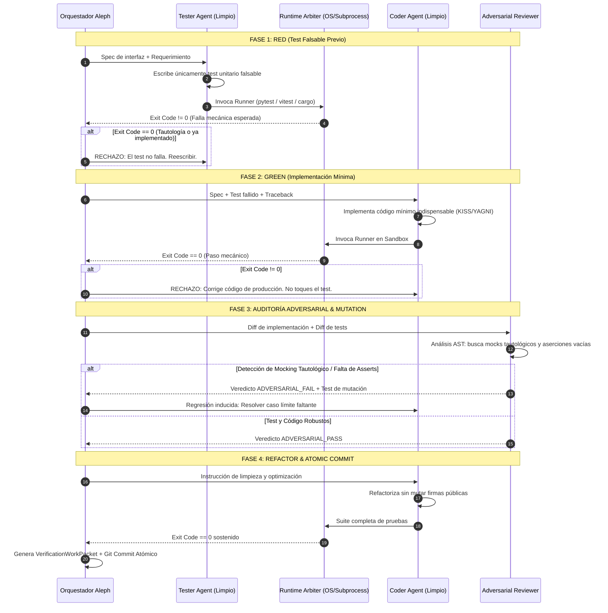

# PLAN MAESTRO PRAGMÁTICO // PARTE 2: MOTOR DE VERIFICACIÓN MECÁNICA, TDD ADVERSARIAL Y SANDBOXING

> **Documento:** `plan_02_verification_engine.md`  
> **Subsistema:** Aleph Core // Runtime de Verificación & Motor TDD Adversarial  
> **Estado:** ESPECIFICACIÓN TÉCNICA NORMATIVA Y PLAN DE CONSTRUCCIÓN EJECUTABLE  
> **Referencia Doctrinaria:** `analysis_02_verification_tdd.md`, `affaan-m/ECC` (Everything Claude Code), Superpowers Agent Protocol  
> **Fecha:** Octubre 2026  
> **Target de Ejecución:** Windows 11 x64 / PowerShell 7 / Python 3.12+ / Git 2.40+  

---

## 1. Fundamentos de Primeros Principios y Doctrina Pragmática

### 1.1 Deconstrucción Definitiva del "Teatro Cripto-Epistémico"
El diseño legacy de la "Compuerta Epistémica" (`04_truth.md`, `08_sandbox.md`) pretendía resolver la corrección del software mediante formalismos cosméticos:
1. **El falso SHA-256 de STDOUT:** Calcular `sha256(stdout)` o `sha256(stderr)` es criptografía decorativa. Un script con `assert True`, aserciones comentadas o `print("ALL TESTS PASSED")` produce un digest SHA-256 matemáticamente válido pero garantiza cero corrección de software.
2. **Micro-sintaxis obstructiva:** Prefijos como `[VERIFIED::exec:<id>]` devoran tokens, fragmentan el razonamiento de los LLMs y no aportan garantías de ejecución.
3. **Thrashing por invalidación global:** Invalidar todo el grafo epistemológico ante cualquier cambio de whitespace o comentario en un archivo Markdown (`FS Dirty State = True`) inutiliza el sistema en desarrollo real.
4. **Fantasía de hardware:** Invocar enclaves confidenciales AMD SEV-SNP o microVMs Hyper-V en estaciones de desarrollo local ocultaba la falta de primitivas básicas: aislamiento de subprocesos, control de variables de entorno y protección del working tree.

### 1.2 La Dictadura del Código de Salida (Exit Code Supremacy)
En la ingeniería pragmática, la única señal determinista e incuestionable de éxito o fallo de un comando es el código de retorno del proceso emitido por el kernel del sistema operativo:

$$\text{Veredicto}(\mathcal{P}) = \begin{cases} \mathbf{PASS}, & \text{si } \text{ExitCode}(\mathcal{P}) = 0 \\ \mathbf{FAIL}, & \text{si } \text{ExitCode}(\mathcal{P}) \neq 0 \end{cases}$$

- **Ninguna interpretación de texto por un LLM puede revocar un exit code.** Si un runner devuelve `exit_code = 1`, el veredicto es fallo estricto, independientemente de cualquier argumentación generada por el modelo.
- **Zero-Ambiguity Contract:** La verdad de una prueba unitaria reside en el proceso del runner evaluando aserciones compiladas/interpretadas en memoria, no en la prosa del modelo.

### 1.3 Mapeo Determinista de Tooling Nativo por Ecosistema
El motor de Aleph no inventa wrappers opacos; delega directamente en las herramientas estándar de la industria del repositorio anfitrión:

| Ecosistema | Runner de Pruebas | Tipado Estático | Linter & Formatter | Comando de Verificación Determinista |
| :--- | :--- | :--- | :--- | :--- |
| **Python** | `pytest` | `mypy` / `pyright` | `ruff` | `pytest tests/ -q && ruff check . && mypy .` |
| **Node / TS** | `vitest` / `jest` | `tsc --noEmit` | `eslint` / `biome` | `npx vitest run && npx tsc --noEmit && npx eslint .` |
| **Rust** | `cargo test` | Compilador `rustc` | `cargo clippy` | `cargo check && cargo clippy -- -D warnings && cargo test` |
| **Go** | `go test` | Compilador `go` | `golangci-lint` | `go test -race ./... && golangci-lint run` |

### 1.4 Normalización de Salida y Manejo de Encoding en Windows
En estaciones Windows, los subprocesos frecuentemente emiten salida codificada en páginas de código locales (`cp1252`, `cp850`) o `utf-8` con o sin BOM, además de códigos de control ANSI VT100:
- **Decodificación Robusta:** Decodificación explícita en `utf-8` con estrategia `errors="replace"` para evitar excepciones de decodificación en buffers binarios mixtos.
- **Stripping de Secuencias de Escape ANSI:** Limpieza determinista mediante expresiones regulares antes de persistir o analizar el runlog, preservando el log crudo en disco si se requiere auditoría forense.
- **Cronometría de Alta Resolución:** Medición de latencia de ejecución mediante `time.perf_counter_ns()` para registrar tiempos precisos al milisegundo.

---

## 2. Arquitectura Desacoplada del Pipeline TDD Adversarial

### 2.1 Eliminación Matemática del Sesgo de Confirmación
Cuando un agente implementa código y luego diseña las pruebas en la misma ventana de contexto, el sistema sufre de **sesgo de confirmación cognitivo**:
- El modelo escribe tests que validan exactamente el camino feliz que él mismo programó.
- Ante un error, tiende a mutar la aserción del test para que coincida con el bug de la implementación.
- Los casos de borde no contemplados en el diseño original jamás son probados.

**Regla de Desacoplamiento Estricto:** El implementador (`Coder`) y el evaluador (`Tester`) operan en **subagentes aislados con ventanas de contexto independientes**.

```
                           ┌────────────────────────┐
                           │      Orquestador       │
                           │   (Spec & Requisitos)  │
                           └───────────┬────────────┘
                                       │
                  ┌────────────────────┴────────────────────┐
                  ▼                                         ▼
       ┌─────────────────────┐                   ┌─────────────────────┐
       │    Tester Agent     │                   │     Coder Agent     │
       │  (Contexto Limpio)  │                   │    (Implementador)  │
       │                     │                   │                     │
       │ • No ve CoT Coder   │                   │ • Recibe test + spec│
       │ • Escribe test RED  │                   │ • Código mínimo     │
       │ • Genera mutaciones │                   │ • Prohibido tocar   │
       │   adversariales     │                   │   los tests         │
       └──────────┬──────────┘                   └──────────┬──────────┘
                  │                                         │
                  │   ┌─────────────────────────────────┐   │
                  └──►│     Runtime Arbiter (SO)        │◄──┘
                      │                                 │
                      │  • Proceso nativo aislado       │
                      │  • Exit code == 0 / != 0        │
                      │  • Git unified diff atómico     │
                      └─────────────────────────────────┘
```

### 2.2 Ciclo de Cuatro Fases: Red-Green-Audit-Refactor



### 2.3 Especificación de Contratos por Fase

#### Fase 1: RED
- **Entrada al Tester:** Requisito formal, contrato de API/interfaz esperado, tipos Pydantic/TypeScript solicitados.
- **Regla:** El Tester **no tiene permiso de editar archivos fuera del directorio de tests** (`tests/**`, `src/**/*.test.ts`).
- **Compuerta de Salida (Gate RED):**
  - $\text{ExitCode} \neq 0$.
  - La falla debe ser semántica (`AssertionError`, `NotImplementedError`, `AttributeError` por símbolo inexistente), **nunca error de sintaxis del propio archivo de test** (`SyntaxError`, `IndentationError`).
  - Si $\text{ExitCode} == 0$, el test es invalidado de inmediato: o la funcionalidad ya existía o el test es una tautología (`assert True`).

#### Fase 2: GREEN
- **Entrada al Coder:** Archivo de test generado en Fase 1, stacktrace del fallo mecánico, especificación funcional.
- **Regla:** El Coder **tiene prohibido modificar el archivo de test**. Si intenta cambiar la aserción para pasar la prueba, el orquestador aborta la ejecución y revierte sus cambios vía `git checkout`.
- **Compuerta de Salida (Gate GREEN):**
  - $\text{ExitCode} == 0$.
  - Cero regresiones en la suite preexistente.

#### Fase 3: AUDITORÍA ADVERSARIAL & ANTI-MOCKING
Un revisor hostil independiente ejecuta un análisis estático por AST (*Abstract Syntax Tree*) y mutaciones heurísticas:
- **Anti-Patrón 1 (Mock Tautológico):** Mockear la función exacta bajo prueba o mockear retornos sin comprobar efectos colaterales de estado.
- **Anti-Patrón 2 (Asertar la Implementación):** Probar variables privadas internas en lugar del contrato público.
- **Anti-Patrón 3 (Test Vacío / Inerte):** Funciones de test sin sentencias de aserción reales o aserciones triviales (`assert result is not None` sin verificar contenido).

#### Fase 4: REFACTOR & COMMIT ATÓMICO
- El código se estiliza, se eliminan duplicaciones y se optimiza.
- Se ejecuta la suite completa de pruebas mecánicas asegurando $\text{ExitCode} == 0$.
- Se empaqueta el `VerificationWorkPacket` y se efectúa el commit atómico en Git.

---

## 3. Modelo de Datos: `VerificationWorkPacket`

El `VerificationWorkPacket` sustituye definitivamente el falso hash SHA-256 de STDOUT por un contenedor auditable, inmutable y serializable.

### 3.1 Esquema Pydantic v2 de Producción

```python
"""
aleph_verification_models.py
Modelos de datos formales para el Motor de Verificación de El Aleph.
Compatible con Pydantic v2.
"""

from __future__ import annotations
from datetime import datetime, timezone
from enum import Enum
from typing import List, Dict, Optional, Any
from pydantic import BaseModel, Field, ConfigDict, computed_field


class VerificationPhase(str, Enum):
    RED = "RED"
    GREEN = "GREEN"
    ADVERSARIAL = "ADVERSARIAL"
    REFACTOR = "REFACTOR"


class ExecutionVerdict(str, Enum):
    PASS = "PASS"
    FAIL = "FAIL"
    TIMEOUT = "TIMEOUT"
    EXEC_ERROR = "EXEC_ERROR"


class EnvironmentMetadata(BaseModel):
    model_config = ConfigDict(frozen=True)

    os_platform: str = Field(..., description="Nombre del sistema operativo (e.g. windows-11-x64)")
    shell: str = Field(..., description="Shell utilizada (e.g. powershell-7, cmd.exe, bash)")
    runtime_version: str = Field(..., description="Versión exacta del runtime (e.g. python-3.12.2)")
    working_directory: str = Field(..., description="Ruta absoluta del working directory de ejecución")
    git_head_before: str = Field(..., description="Hash SHA-1/SHA-256 de HEAD antes de la ejecución")
    git_head_after: Optional[str] = Field(None, description="Hash de HEAD tras la ejecución (si hubo commit)")
    is_sandboxed: bool = Field(True, description="Indica si se ejecutó en sandbox (worktree / subshell sanitizado)")


class ExecutionMetadata(BaseModel):
    model_config = ConfigDict(frozen=True)

    command: str = Field(..., description="Comando exacto ejecutado en el sistema operativo")
    command_argv: List[str] = Field(..., description="Argumentos tokenizados del proceso")
    exit_code: int = Field(..., description="Código de salida del proceso retornado por el kernel")
    duration_ms: float = Field(..., ge=0.0, description="Duración de la ejecución en milisegundos")
    timestamp_utc: datetime = Field(
        default_factory=lambda: datetime.now(timezone.utc),
        description="Marca temporal UTC de la ejecución"
    )
    timed_out: bool = Field(False, description="True si el proceso fue terminado por exceder el timeout")


class GitDiffSummary(BaseModel):
    model_config = ConfigDict(frozen=True)

    files_changed: List[str] = Field(default_factory=list, description="Lista de archivos modificados")
    files_added: List[str] = Field(default_factory=list, description="Lista de archivos creados")
    files_deleted: List[str] = Field(default_factory=list, description="Lista de archivos eliminados")
    insertions: int = Field(0, ge=0, description="Número de líneas añadidas según git diff --numstat")
    deletions: int = Field(0, ge=0, description="Número de líneas eliminadas según git diff --numstat")
    unified_diff: str = Field("", description="Patch unificado completo (git diff)")


class RunlogPayload(BaseModel):
    model_config = ConfigDict(frozen=True)

    stdout_clean: str = Field(..., description="Salida estándar sin secuencias de escape ANSI")
    stderr_clean: str = Field(..., description="Salida de error sin secuencias de escape ANSI")
    truncated: bool = Field(False, description="Indica si la salida superó el límite de captura")
    raw_bytes_stdout_len: int = Field(..., ge=0, description="Tamaño en bytes del stdout original")
    raw_bytes_stderr_len: int = Field(..., ge=0, description="Tamaño en bytes del stderr original")


class VerificationWorkPacket(BaseModel):
    model_config = ConfigDict(frozen=True)

    packet_id: str = Field(..., description="Identificador único del paquete (e.g. vwp-20261012-001)")
    task_id: str = Field(..., description="Identificador de la tarea u objetivo")
    phase: VerificationPhase = Field(..., description="Fase del ciclo TDD en que se emitió el paquete")
    environment: EnvironmentMetadata = Field(..., description="Metadatos del entorno anfitrión")
    execution: ExecutionMetadata = Field(..., description="Metadatos de la corrida del proceso")
    diff_summary: GitDiffSummary = Field(..., description="Resumen de cambios de Git")
    runlog: RunlogPayload = Field(..., description="Logs sanitizados de ejecución")
    adversarial_notes: Optional[str] = Field(None, description="Observaciones del revisor hostil o AST audit")

    @computed_field
    @property
    def verdict(self) -> ExecutionVerdict:
        if self.execution.timed_out:
            return ExecutionVerdict.TIMEOUT
        if self.phase == VerificationPhase.RED:
            # En fase RED, el éxito es que falle por aserción
            return ExecutionVerdict.PASS if self.execution.exit_code != 0 else ExecutionVerdict.FAIL
        else:
            # En GREEN, ADVERSARIAL o REFACTOR, el éxito es exit_code == 0
            return ExecutionVerdict.PASS if self.execution.exit_code == 0 else ExecutionVerdict.FAIL

    @computed_field
    @property
    def is_valid(self) -> bool:
        """Determina si el paquete cumple la compuerta mecánica de su fase."""
        return self.verdict == ExecutionVerdict.PASS
```

---

## 4. Estrategia de Sandboxes Prácticos en Windows

### 4.1 La Realidad Operativa del Host Windows
En Windows 11 para desarrollo local:
- No existen namespaces nativos de Linux ni cgroups sin virtualización.
- La ejecución de scripts PowerShell (`.ps1`) frecuentemente colisiona con directivas de `ExecutionPolicy`.
- Los bloqueos de archivos en sistemas de archivos NTFS (*file locking*) generan fallos intermitentes al intentar eliminar directorios si un proceso en segundo plano (e.g., analizador de lenguaje, antivirus o indexador) mantiene un handle abierto.

Para garantizar contención y reproducibilidad sin recurrir a enclaves de hardware ficticios, Aleph define **tres niveles progresivos de aislamiento**:

```
┌────────────────────────────────────────────────────────────────────────┐
│ Nivel 1: Entorno Virtual & Subshells Sanitizados (<50ms overhead)      │
│ • Resolución directa de binarios en .venv/Scripts sin pasar por .ps1   │
│ • Subprocess aislado con Job Objects / Process Groups en Windows       │
│ • Purgado de variables de entorno (allowlist estricta; borrado secrets)│
│ • Timeout perentorio con árbol de terminación forzada (taskkill /F /T) │
└────────────────────────────────────┬───────────────────────────────────┘
                                     │
┌────────────────────────────────────▼───────────────────────────────────┐
│ Nivel 2: Filesystem Worktree Isolation (Git Worktrees efímeros)        │
│ • `git worktree add -b aleph/task-xyz .aleph/worktrees/task-xyz HEAD`  │
│ • Working directory del usuario 100% protegido contra corrupción       │
│ • Merge atómico con Fast-Forward solo si todos los tests pasan         │
│ • Mecanismo anti-bloqueo NTFS con retry exponencial para limpieza      │
└────────────────────────────────────┬───────────────────────────────────┘
                                     │
┌────────────────────────────────────▼───────────────────────────────────┐
│ Nivel 3: Contención Virtualizada (WSL2 / Docker) (Para código hostil)  │
│ • Invocación mediante `wsl.exe -d Ubuntu -- <cmd>`                     │
│ • Namespaces de Linux reales para scripts de procedencia desconocida   │
│ • Montajes restringidos de solo lectura para el árbol fuente           │
└────────────────────────────────────────────────────────────────────────┘
```

### 4.2 Especificación Detallada de los Niveles

#### Tier 1: Entorno Virtual Nativo y Subshells Sanitizados
1. **Resolución Determinista de Binarios:**
   - Para Python: Aleph busca secuencialmente `.venv/Scripts/python.exe`, `venv/Scripts/python.exe` o utiliza `uv run --`. No ejecuta scripts de activación (`activate.ps1`).
   - Para Node: Ejecuta directamente binarios en `node_modules/.bin/` o invoca vía `npx --no-install`.
2. **Sanitización de Variables de Entorno (Environment Scrubbing):**
   - El proceso hijo se ejecuta con un diccionario de entorno filtrado por **Allowlist Estricta**:
     - Variables seguras del sistema: `SYSTEMROOT`, `SYSTEMDRIVE`, `WINDIR`, `PATH`, `PATHEXT`, `TEMP`, `TMP`, `COMSPEC`, `NUMBER_OF_PROCESSORS`, `PROCESSOR_ARCHITECTURE`.
     - Variables del runtime: `PYTHONPATH`, `PYTHONIOENCODING=utf-8`, `NODE_PATH`.
   - **Purga de Credenciales:** Toda variable que coincida con patrones como `*_API_KEY`, `*_SECRET`, `*_TOKEN`, `*_AUTH`, `AWS_*`, `OPENAI_*`, `ANTHROPIC_*`, `GEMINI_*`, `GITHUB_TOKEN` es eliminada inmediatamente del bloque de memoria del proceso, impidiendo la exfiltración involuntaria o el acceso de suites de pruebas a servicios de pago en vivo.
3. **Manejo de Timeouts y Prevención de Procesos Zombies en Windows:**
   - Los subprocesos en Windows no responden a señales UNIX estándar (`SIGTERM`/`SIGKILL`).
   - Aleph invoca los procesos creando un nuevo grupo de procesos (`creationflags=subprocess.CREATE_NEW_PROCESS_GROUP`).
   - Si se supera el timeout perentorio (default: 30.0 segundos para tests unitarios), se dispara una terminación en árbol mediante el comando nativo de Windows:
     ```powershell
     taskkill /F /T /PID <pid>
     ```
     Esto garantiza la muerte del proceso padre y de cualquier proceso hijo engendrado por compilers o runners (e.g. workers de `pytest-xdist`).

#### Tier 2: Aislamiento del Sistema de Archivos mediante Git Worktrees
1. **Creación Efímera:**
   - Se crea un directorio aislado fuera del árbol de trabajo principal:
     ```powershell
     git worktree add -b aleph/task-{id} .aleph/worktrees/task-{id} HEAD
     ```
   - El agente Coder y el Tester ejecutan sus operaciones exclusivamente dentro de este directorio.
2. **Mitigación de File Locks en NTFS:**
   - En Windows, operaciones como `git worktree remove` pueden fallar con `PermissionError` o `Sharing violation` si un editor o el Search Indexer retiene un handle de archivo.
   - Aleph implementa un algoritmo de limpieza con reintentos exponenciales (3 intentos con backoff de 500ms, 1000ms, 2000ms) y forzado de atributos de solo lectura (`os.chmod(stat.S_IWRITE)`).
3. **Fusión Atómica o Aborto:**
   - Si la suite completa pasa (`Exit Code == 0` en GREEN y REFACTOR):
     ```powershell
     git checkout main
     git merge --ff-only aleph/task-{id}
     git worktree remove .aleph/worktrees/task-{id} --force
     git branch -d aleph/task-{id}
     ```
   - Si el ciclo se aborta por fallo no recuperable:
     ```powershell
     git worktree remove .aleph/worktrees/task-{id} --force
     git branch -D aleph/task-{id}
     ```
     El working tree del desarrollador jamás sufre contaminación ni pérdidas de cambios en progreso.

---

## 5. Implementación del Motor: `aleph_verification_engine.py`

A continuación se detalla la implementación en código Python production-grade del motor de verificación, contención y orquestación TDD.

```python
"""
aleph_verification_engine.py
Motor de Verificación Mecánica, Sandboxing y TDD Adversarial para El Aleph.
Diseñado para ejecución robusta en Windows 11 x64 y Linux.
"""

from __future__ import annotations
import ast
import os
import re
import shutil
import stat
import subprocess
import time
import uuid
from dataclasses import dataclass
from datetime import datetime, timezone
from pathlib import Path
from typing import Dict, List, Optional, Tuple, Set

# Importación de los modelos Pydantic
from pydantic import ValidationError
from aleph_verification_models import (
    VerificationWorkPacket,
    VerificationPhase,
    ExecutionVerdict,
    EnvironmentMetadata,
    ExecutionMetadata,
    GitDiffSummary,
    RunlogPayload,
)

# Regex para remover códigos de escape ANSI
ANSI_ESCAPE_REGEX = re.compile(r"\x1B(?:[@-Z\\-_]|\[[0-?]*[ -/]*[@-~])")

# Variables de entorno críticas permitidas (Allowlist de Windows)
SAFE_ENV_ALLOWLIST = {
    "SYSTEMROOT",
    "SYSTEMDRIVE",
    "WINDIR",
    "PATH",
    "PATHEXT",
    "TEMP",
    "TMP",
    "COMSPEC",
    "NUMBER_OF_PROCESSORS",
    "PROCESSOR_ARCHITECTURE",
    "PROGRAMDATA",
    "LOCALAPPDATA",
    "APPDATA",
    "USERPROFILE",
    "HOMEDRIVE",
    "HOMEPATH",
    "OS",
}

# Patrones de variables prohibidas que contienen credenciales o secretos
FORBIDDEN_ENV_PATTERNS = [
    re.compile(r".*_KEY$", re.IGNORECASE),
    re.compile(r".*_SECRET$", re.IGNORECASE),
    re.compile(r".*_TOKEN$", re.IGNORECASE),
    re.compile(r".*_AUTH.*", re.IGNORECASE),
    re.compile(r"^AWS_.*", re.IGNORECASE),
    re.compile(r"^OPENAI_.*", re.IGNORECASE),
    re.compile(r"^ANTHROPIC_.*", re.IGNORECASE),
    re.compile(r"^GEMINI_.*", re.IGNORECASE),
    re.compile(r"^GITHUB_.*", re.IGNORECASE),
]


def clean_ansi(text: str) -> str:
    """Elimina secuencias de control ANSI VT100 del texto."""
    return ANSI_ESCAPE_REGEX.sub("", text)


def sanitize_environment(extra_env: Optional[Dict[str, str]] = None) -> Dict[str, str]:
    """
    Construye un entorno de variables purgado.
    Mantiene únicamente variables de sistema necesarias y purga claves y secretos.
    """
    clean_env: Dict[str, str] = {}
    for key, value in os.environ.items():
        if key.upper() in SAFE_ENV_ALLOWLIST:
            # Comprobar que no coincida con patrones sensibles
            if not any(pattern.match(key) for pattern in FORBIDDEN_ENV_PATTERNS):
                clean_env[key] = value

    # Configuración de encoding estándar y buffers limpios
    clean_env["PYTHONIOENCODING"] = "utf-8"
    clean_env["PYTHONUNBUFFERED"] = "1"
    clean_env["CI"] = "1"

    if extra_env:
        for k, v in extra_env.items():
            if not any(pattern.match(k) for pattern in FORBIDDEN_ENV_PATTERNS):
                clean_env[k] = v

    return clean_env


class ExecutionRunner:
    """
    Ejecutor mecánico de subprocesos con control estricto de timeout,
    limpieza de variables de entorno y captura de salida.
    """

    def __init__(self, default_timeout_sec: float = 30.0):
        self.default_timeout_sec = default_timeout_sec

    def run_command(
        self,
        command_argv: List[str],
        cwd: Path,
        timeout_sec: Optional[float] = None,
        extra_env: Optional[Dict[str, str]] = None,
        max_output_bytes: int = 1_000_000,
    ) -> Tuple[int, str, str, float, bool]:
        """
        Ejecuta un comando en un proceso hijo aislado.

        Retorna:
            (exit_code, stdout_clean, stderr_clean, duration_ms, timed_out)
        """
        timeout = timeout_sec or self.default_timeout_sec
        env = sanitize_environment(extra_env)

        # Flags de creación de proceso para aislamiento en Windows
        creationflags = 0
        if os.name == "nt":
            creationflags = subprocess.CREATE_NEW_PROCESS_GROUP

        start_time_ns = time.perf_counter_ns()
        timed_out = False
        stdout_raw = b""
        stderr_raw = b""
        exit_code = -1

        try:
            proc = subprocess.Popen(
                command_argv,
                cwd=str(cwd),
                stdin=subprocess.DEVNULL,
                stdout=subprocess.PIPE,
                stderr=subprocess.PIPE,
                env=env,
                creationflags=creationflags,
            )

            try:
                stdout_bytes, stderr_bytes = proc.communicate(timeout=timeout)
                stdout_raw = stdout_bytes or b""
                stderr_raw = stderr_bytes or b""
                exit_code = proc.returncode
            except subprocess.TimeoutExpired:
                timed_out = True
                self._terminate_process_tree(proc.pid)
                # Recoger lo que se haya escrito antes del timeout
                try:
                    stdout_bytes, stderr_bytes = proc.communicate(timeout=2.0)
                    stdout_raw = stdout_bytes or b""
                    stderr_raw = stderr_bytes or b""
                except Exception:
                    pass
                exit_code = 124  # Código estándar para timeout en Linux/POSIX

        except FileNotFoundError as fnf:
            exit_code = 127  # Comando no encontrado
            stderr_raw = f"Executable not found: {command_argv[0]} - {fnf}".encode("utf-8")
        except Exception as ex:
            exit_code = 1
            stderr_raw = f"Execution failure: {str(ex)}".encode("utf-8")

        end_time_ns = time.perf_counter_ns()
        duration_ms = (end_time_ns - start_time_ns) / 1_000_000.0

        # Truncar si excede el tamaño máximo
        if len(stdout_raw) > max_output_bytes:
            stdout_raw = stdout_raw[:max_output_bytes] + b"\n... [TRUNCATED BY ALEPH RUNNER]"
        if len(stderr_raw) > max_output_bytes:
            stderr_raw = stderr_raw[:max_output_bytes] + b"\n... [TRUNCATED BY ALEPH RUNNER]"

        stdout_clean = clean_ansi(stdout_raw.decode("utf-8", errors="replace"))
        stderr_clean = clean_ansi(stderr_raw.decode("utf-8", errors="replace"))

        return exit_code, stdout_clean, stderr_clean, duration_ms, timed_out

    def _terminate_process_tree(self, pid: int) -> None:
        """Termina forzosamente el árbol de procesos en Windows o POSIX."""
        if os.name == "nt":
            # Forzar terminación del árbol completo con taskkill en Windows
            try:
                subprocess.run(
                    ["taskkill", "/F", "/T", "/PID", str(pid)],
                    stdout=subprocess.DEVNULL,
                    stderr=subprocess.DEVNULL,
                    timeout=5.0,
                    check=False,
                )
            except Exception:
                pass
        else:
            try:
                os.kill(pid, 9)  # SIGKILL
            except Exception:
                pass


class WorktreeManager:
    """
    Administrador de Git Worktrees para sandboxing de filesystem en Windows.
    Previene la contaminación del working tree principal y gestiona bloqueos NTFS.
    """

    def __init__(self, repo_root: Path):
        self.repo_root = repo_root.resolve()
        self.worktrees_dir = self.repo_root / ".aleph" / "worktrees"
        self.worktrees_dir.mkdir(parents=True, exist_ok=True)

    def create_worktree(self, task_id: str, base_ref: str = "HEAD") -> Tuple[Path, str]:
        """
        Crea un worktree aislado en una rama efímera.
        Retorna (ruta_absoluta_del_worktree, nombre_de_la_rama).
        """
        branch_name = f"aleph/task-{task_id}"
        worktree_path = self.worktrees_dir / f"wt-{task_id}"

        if worktree_path.exists():
            self.remove_worktree(worktree_path, branch_name)

        cmd = [
            "git",
            "worktree",
            "add",
            "-b",
            branch_name,
            str(worktree_path),
            base_ref,
        ]

        result = subprocess.run(
            cmd,
            cwd=str(self.repo_root),
            capture_output=True,
            text=True,
            check=False,
        )

        if result.returncode != 0:
            raise RuntimeError(
                f"Fallo al crear git worktree: {result.stderr.strip()}"
            )

        return worktree_path, branch_name

    def remove_worktree(self, worktree_path: Path, branch_name: Optional[str] = None) -> None:
        """
        Elimina un worktree y su rama asociada con reintentos para mitigar locks en NTFS.
        """
        # Paso 1: Eliminar registro en Git
        subprocess.run(
            ["git", "worktree", "remove", "--force", str(worktree_path)],
            cwd=str(self.repo_root),
            stdout=subprocess.DEVNULL,
            stderr=subprocess.DEVNULL,
            check=False,
        )

        # Paso 2: Si quedan archivos residuales en disco (frecuente en NTFS), limpiar con retry
        if worktree_path.exists():
            self._force_remove_directory(worktree_path)

        # Paso 3: Podar registros de worktree obsoletos en Git
        subprocess.run(
            ["git", "worktree", "prune"],
            cwd=str(self.repo_root),
            stdout=subprocess.DEVNULL,
            stderr=subprocess.DEVNULL,
            check=False,
        )

        # Paso 4: Eliminar la rama efímera si se especificó
        if branch_name:
            subprocess.run(
                ["git", "branch", "-D", branch_name],
                cwd=str(self.repo_root),
                stdout=subprocess.DEVNULL,
                stderr=subprocess.DEVNULL,
                check=False,
            )

    def _force_remove_directory(self, path: Path, max_retries: int = 3) -> None:
        """Elimina un directorio superando bloqueos temporales de lectura/escritura en Windows."""
        def handle_remove_readonly(func, file_path, exc):
            os.chmod(file_path, stat.S_IWRITE)
            func(file_path)

        for attempt in range(max_retries):
            try:
                shutil.rmtree(path, onerror=handle_remove_readonly)
                return
            except Exception:
                time.sleep(0.5 * (2**attempt))

        # Último recurso en Windows: rmdir nativo por cmd
        if os.name == "nt" and path.exists():
            subprocess.run(
                ["cmd", "/c", "rmdir", "/s", "/q", str(path)],
                stdout=subprocess.DEVNULL,
                stderr=subprocess.DEVNULL,
                check=False,
            )


class AdversarialASTAuditor:
    """
    Auditor estático de tests unitarios de Python mediante AST.
    Detecta anti-patrones: mocks tautológicos, tests sin aserciones y tests ciegos.
    """

    @classmethod
    def audit_test_file(cls, test_file_path: Path) -> List[str]:
        """
        Analiza el archivo de prueba y retorna una lista de hallazgos/violaciones detectadas.
        """
        if not test_file_path.exists() or test_file_path.suffix != ".py":
            return []

        findings: List[str] = []
        try:
            tree = ast.parse(test_file_path.read_text(encoding="utf-8"))
        except Exception as ex:
            return [f"Error al parsear AST del archivo de test: {ex}"]

        for node in ast.walk(tree):
            if isinstance(node, (ast.FunctionDef, ast.AsyncFunctionDef)):
                if node.name.startswith("test_"):
                    findings.extend(cls._inspect_test_function(node))

        return findings

    @classmethod
    def _inspect_test_function(cls, func_node: ast.FunctionDef | ast.AsyncFunctionDef) -> List[str]:
        findings: List[str] = []
        has_assert = False
        has_tautological_assert = False

        for subnode in ast.walk(func_node):
            # Detección de sentencias assert
            if isinstance(subnode, ast.Assert):
                has_assert = True
                # Detectar assert True o assert 1
                if isinstance(subnode.test, ast.Constant):
                    if subnode.test.value is True or subnode.test.value == 1:
                        has_tautological_assert = True
                # Detectar assert variable == variable
                elif isinstance(subnode.test, ast.Compare):
                    left = ast.unparse(subnode.test.left)
                    for comparator in subnode.test.comparators:
                        if ast.unparse(comparator) == left:
                            has_tautological_assert = True

            # Detección de aserciones de unittest (self.assertEqual, etc.)
            elif isinstance(subnode, ast.Call):
                func_name = ""
                if isinstance(subnode.func, ast.Attribute):
                    func_name = subnode.func.attr
                elif isinstance(subnode.func, ast.Name):
                    func_name = subnode.func.id

                if func_name.startswith("assert"):
                    has_assert = True
                    if func_name == "assertTrue" and len(subnode.args) > 0:
                        if isinstance(subnode.args[0], ast.Constant) and subnode.args[0].value is True:
                            has_tautological_assert = True

        if not has_assert:
            findings.append(
                f"Test inerte: '{func_node.name}' no contiene ninguna sentencia de aserción (assert)."
            )
        if has_tautological_assert:
            findings.append(
                f"Aserción tautológica en '{func_node.name}': evalúa una verdad trivial (e.g. assert True o x == x)."
            )

        return findings


class VerificationEngine:
    """
    Orquestador principal del subsistema de verificación mecánica de El Aleph.
    Empaqueta la ejecución, genera VerificationWorkPackets y gobierna las fases TDD.
    """

    def __init__(self, repo_root: Path):
        self.repo_root = repo_root.resolve()
        self.runner = ExecutionRunner()
        self.worktree_manager = WorktreeManager(self.repo_root)
        self.packets_dir = self.repo_root / ".aleph" / "verification_packets"
        self.packets_dir.mkdir(parents=True, exist_ok=True)

    def execute_and_record(
        self,
        task_id: str,
        phase: VerificationPhase,
        command_argv: List[str],
        cwd: Path,
        test_file_to_audit: Optional[Path] = None,
        timeout_sec: Optional[float] = None,
    ) -> VerificationWorkPacket:
        """
        Ejecuta mecánicamente el comando de prueba y produce un VerificationWorkPacket inmutable.
        """
        # 1. Obtener estado de Git previo
        head_before = self._get_git_commit_hash(cwd)

        # 2. Ejecutar comando
        exit_code, stdout, stderr, duration_ms, timed_out = self.runner.run_command(
            command_argv=command_argv,
            cwd=cwd,
            timeout_sec=timeout_sec,
        )

        # 3. Auditoría Adversarial AST si aplica
        adversarial_notes: Optional[str] = None
        if test_file_to_audit and test_file_to_audit.exists():
            findings = AdversarialASTAuditor.audit_test_file(test_file_to_audit)
            if findings:
                adversarial_notes = "\n".join(findings)
                # Si encontramos un test tautológico, invalidar forzosamente la corrida
                if phase == VerificationPhase.RED and exit_code == 0:
                    exit_code = 2  # Falla de verificación por tautología detectada

        # 4. Capturar git diff post-ejecución
        diff_summary = self._capture_git_diff(cwd)
        head_after = self._get_git_commit_hash(cwd)

        # 5. Construir metadatos del entorno
        env_meta = EnvironmentMetadata(
            os_platform=f"{os.name}-win11-x64" if os.name == "nt" else "posix-linux-x64",
            shell="powershell-7" if os.name == "nt" else "bash",
            runtime_version="python-3.12+",
            working_directory=str(cwd.resolve()),
            git_head_before=head_before,
            git_head_after=head_after,
            is_sandboxed=True,
        )

        exec_meta = ExecutionMetadata(
            command=" ".join(command_argv),
            command_argv=command_argv,
            exit_code=exit_code,
            duration_ms=duration_ms,
            timestamp_utc=datetime.now(timezone.utc),
            timed_out=timed_out,
        )

        runlog = RunlogPayload(
            stdout_clean=stdout,
            stderr_clean=stderr,
            truncated=len(stdout) >= 1_000_000 or len(stderr) >= 1_000_000,
            raw_bytes_stdout_len=len(stdout.encode("utf-8")),
            raw_bytes_stderr_len=len(stderr.encode("utf-8")),
        )

        packet_id = f"vwp-{datetime.now(timezone.utc).strftime('%Y%m%d%H%M%S')}-{uuid.uuid4().hex[:6]}"

        packet = VerificationWorkPacket(
            packet_id=packet_id,
            task_id=task_id,
            phase=phase,
            environment=env_meta,
            execution=exec_meta,
            diff_summary=diff_summary,
            runlog=runlog,
            adversarial_notes=adversarial_notes,
        )

        # 6. Persistir el paquete a disco
        self._persist_packet(packet)

        return packet

    def _persist_packet(self, packet: VerificationWorkPacket) -> Path:
        """Guarda el VerificationWorkPacket serializado en formato JSON."""
        target_file = self.packets_dir / f"{packet.packet_id}.json"
        target_file.write_text(packet.model_dump_json(indent=2), encoding="utf-8")
        return target_file

    def _get_git_commit_hash(self, cwd: Path) -> str:
        """Obtiene el hash del commit HEAD actual."""
        try:
            res = subprocess.run(
                ["git", "rev-parse", "HEAD"],
                cwd=str(cwd),
                capture_output=True,
                text=True,
                check=False,
            )
            return res.stdout.strip() if res.returncode == 0 else "0000000000000000000000000000000000000000"
        except Exception:
            return "UNKNOWN"

    def _capture_git_diff(self, cwd: Path) -> GitDiffSummary:
        """Captura las estadísticas y el diff unificado del working tree."""
        try:
            numstat_res = subprocess.run(
                ["git", "diff", "--numstat"],
                cwd=str(cwd),
                capture_output=True,
                text=True,
                check=False,
            )
            patch_res = subprocess.run(
                ["git", "diff"],
                cwd=str(cwd),
                capture_output=True,
                text=True,
                check=False,
            )

            insertions = 0
            deletions = 0
            files_changed = []

            if numstat_res.returncode == 0 and numstat_res.stdout:
                for line in numstat_res.stdout.strip().splitlines():
                    parts = line.split("\t")
                    if len(parts) >= 3:
                        ins = int(parts[0]) if parts[0].isdigit() else 0
                        dels = int(parts[1]) if parts[1].isdigit() else 0
                        file_path = parts[2]
                        insertions += ins
                        deletions += dels
                        files_changed.append(file_path)

            unified_diff = patch_res.stdout if patch_res.returncode == 0 else ""

            return GitDiffSummary(
                files_changed=files_changed,
                insertions=insertions,
                deletions=deletions,
                unified_diff=unified_diff,
            )
        except Exception:
            return GitDiffSummary()
```

---

## 6. Contratos de Prueba de la Suite de Verificación (`test_verification_engine.py`)

Para garantizar que el propio motor de verificación se apegue a la Ley de Hierro de TDD y al protocolo EL DEMIURGO, se define su propia suite de pruebas ejecutable con `pytest`.

```python
"""
test_verification_engine.py
Suite de Pruebas Automatizadas para el Motor de Verificación de El Aleph.
Verifica:
1. Supremacía del Exit Code (0 = PASS en Green; != 0 = PASS en Red).
2. Sanitización estricta de variables de entorno y purga de secrets.
3. Ciclo de vida y contención de Git Worktree en Windows.
4. Detección estática mediante AST de tests tautológicos e inertes.
5. Control perentorio de timeout y terminación de subprocesos.
"""

import os
import subprocess
import tempfile
import time
from pathlib import Path
import pytest

from aleph_verification_models import VerificationPhase, ExecutionVerdict
from aleph_verification_engine import (
    ExecutionRunner,
    WorktreeManager,
    AdversarialASTAuditor,
    VerificationEngine,
    sanitize_environment,
)


@pytest.fixture
def temp_repo(tmp_path: Path) -> Path:
    """Crea un repositorio Git temporal inicializado con un commit base."""
    subprocess.run(["git", "init"], cwd=str(tmp_path), check=True, capture_output=True)
    subprocess.run(["git", "config", "user.name", "Aleph Test"], cwd=str(tmp_path), check=True)
    subprocess.run(["git", "config", "user.email", "test@aleph.local"], cwd=str(tmp_path), check=True)
    
    # Crear archivo dummy inicial
    readme = tmp_path / "README.md"
    readme.write_text("# Test Repo\n", encoding="utf-8")
    subprocess.run(["git", "add", "README.md"], cwd=str(tmp_path), check=True)
    subprocess.run(["git", "commit", "-m", "Initial commit"], cwd=str(tmp_path), check=True)
    return tmp_path


class TestVerificationEngineContract:

    def test_exit_code_supremacy_in_green_and_red_phases(self, temp_repo: Path):
        """
        Verifica que el veredicto mecánico obedezca estrictamente al Exit Code según la fase:
        - En RED: exit_code != 0 es PASS; exit_code == 0 es FAIL.
        - En GREEN: exit_code == 0 es PASS; exit_code != 0 es FAIL.
        """
        engine = VerificationEngine(temp_repo)

        # Simular comando que falla (exit code = 1)
        fail_cmd = ["python", "-c", "import sys; sys.exit(1)"]
        packet_red = engine.execute_and_record(
            task_id="TEST-TDD-01",
            phase=VerificationPhase.RED,
            command_argv=fail_cmd,
            cwd=temp_repo,
        )
        assert packet_red.execution.exit_code == 1
        assert packet_red.verdict == ExecutionVerdict.PASS
        assert packet_red.is_valid is True

        # El mismo comando en fase GREEN debe ser veredicto FAIL
        packet_green_fail = engine.execute_and_record(
            task_id="TEST-TDD-01",
            phase=VerificationPhase.GREEN,
            command_argv=fail_cmd,
            cwd=temp_repo,
        )
        assert packet_green_fail.verdict == ExecutionVerdict.FAIL
        assert packet_green_fail.is_valid is False

        # Simular comando exitoso (exit code = 0)
        success_cmd = ["python", "-c", "import sys; sys.exit(0)"]
        packet_green_pass = engine.execute_and_record(
            task_id="TEST-TDD-01",
            phase=VerificationPhase.GREEN,
            command_argv=success_cmd,
            cwd=temp_repo,
        )
        assert packet_green_pass.execution.exit_code == 0
        assert packet_green_pass.verdict == ExecutionVerdict.PASS
        assert packet_green_pass.is_valid is True

    def test_environment_scrubbing_purges_secrets(self, monkeypatch):
        """
        Verifica que variables sensibles (API keys, tokens, credenciales)
        sean purgadas sin excepción del diccionario de variables de entorno.
        """
        monkeypatch.setenv("OPENAI_API_KEY", "sk-secret-12345")
        monkeypatch.setenv("ANTHROPIC_API_KEY", "ant-secret-67890")
        monkeypatch.setenv("MY_SERVICE_SECRET", "super-secret-pass")
        monkeypatch.setenv("SYSTEMROOT", os.environ.get("SYSTEMROOT", "C:\\Windows"))

        clean_env = sanitize_environment()

        assert "OPENAI_API_KEY" not in clean_env
        assert "ANTHROPIC_API_KEY" not in clean_env
        assert "MY_SERVICE_SECRET" not in clean_env
        assert "PYTHONIOENCODING" in clean_env
        assert clean_env["PYTHONIOENCODING"] == "utf-8"

    def test_worktree_isolation_lifecycle_in_windows(self, temp_repo: Path):
        """
        Verifica la creación, aislamiento y eliminación limpia de Git Worktrees.
        """
        wt_manager = WorktreeManager(temp_repo)
        task_id = "WT-TEST-001"

        wt_path, branch = wt_manager.create_worktree(task_id)
        assert wt_path.exists()
        assert (wt_path / "README.md").exists()

        # Mutar archivo dentro del worktree
        dirty_file = wt_path / "new_feature.py"
        dirty_file.write_text("print('isolation verified')\n", encoding="utf-8")

        # Comprobar que el repo principal sigue limpio
        assert not (temp_repo / "new_feature.py").exists()

        # Limpiar worktree
        wt_manager.remove_worktree(wt_path, branch)
        assert not wt_path.exists()

    def test_ast_auditor_detects_tautologies_and_missing_asserts(self, tmp_path: Path):
        """
        Verifica que el analizador AST detecte:
        1. Tests sin aserciones reales (inert tests).
        2. Tests tautológicos (assert True, assert 1 == 1).
        """
        test_file = tmp_path / "test_sample.py"
        test_file.write_text(
            """
def test_inert():
    x = 10
    y = 20

def test_tautology_literal():
    assert True

def test_tautology_identity():
    a = 5
    assert a == a

def test_legitimate():
    val = sum([1, 2, 3])
    assert val == 6
""",
            encoding="utf-8",
        )

        findings = AdversarialASTAuditor.audit_test_file(test_file)
        assert len(findings) == 3
        assert any("no contiene ninguna sentencia de aserción" in f for f in findings)
        assert any("evalúa una verdad trivial" in f for f in findings)

    def test_process_runner_handles_timeout_and_terminates(self, tmp_path: Path):
        """
        Verifica que un proceso que entra en bucle infinito sea terminado
        perentoriamente al alcanzar el timeout sin dejar procesos zombis.
        """
        runner = ExecutionRunner(default_timeout_sec=1.5)
        hang_cmd = ["python", "-c", "import time; time.sleep(10)"]

        exit_code, stdout, stderr, duration_ms, timed_out = runner.run_command(
            hang_cmd, cwd=tmp_path, timeout_sec=1.0
        )

        assert timed_out is True
        assert exit_code == 124
        assert duration_ms >= 1000.0
        assert duration_ms < 3000.0
```

---

## 7. Plan de Implementación Paso a Paso & Criterios de Aceptación

Para construir y desplegar este motor con calidad de clase mundial dentro de El Aleph, se establece un plan dividido en **cinco hitos de ingeniería verificables**:

### Hito 1: Núcleo de Modelos y Runner Mecánico Sanitizado
- **Alcance:**
  - Crear e integrar `aleph_verification_models.py` con validación estricta en Pydantic v2.
  - Implementar `ExecutionRunner` con sanitización de entorno, captura de exit codes y cronometría `time.perf_counter_ns()`.
  - Soporte de terminación en árbol con `taskkill /F /T` para Windows y fallback POSIX.
- **Criterio de Aceptación:**
  - 100% de tests unitarios pasando en `test_exit_code_supremacy_in_green_and_red_phases` y `test_environment_scrubbing_purges_secrets`.

### Hito 2: Sandboxing por Git Worktrees y Mitigación NTFS
- **Alcance:**
  - Implementar `WorktreeManager` gestionando el ciclo de vida completo de ramas efímeras en `.aleph/worktrees/`.
  - Incorporar la lógica de eliminación con reintentos exponenciales para superar locks transitorios del sistema de archivos NTFS en Windows.
- **Criterio de Aceptación:**
  - Crear 10 worktrees concurrentes en bucle y eliminarlos sin errores de `PermissionError` o `Sharing violation`.
  - El árbol principal del repositorio permanece inalterado durante toda la ejecución.

### Hito 3: Auditoría Adversarial AST & Detección de Mocks Huecos
- **Alcance:**
  - Implementar `AdversarialASTAuditor` utilizando el módulo nativo `ast` de Python.
  - Reglas de rechazo para: funciones de test sin `assert`, `assert True`, `assert 1`, y comparaciones tautológicas ($x == x$).
  - Integrar la auditoría en la compuerta de la Fase RED.
- **Criterio de Aceptación:**
  - Rechazar automáticamente cualquier PR o propuesta de test que contenga aserciones inertes con código de error explicativo en `adversarial_notes`.

### Hito 4: Orquestación Desacoplada de Subagentes (Tester vs Coder)
- **Alcance:**
  - Diseñar el arnés de invocación para subagentes con contexto limpio:
    - `TesterSubagent`: Contexto inicializado únicamente con el requerimiento formal y las firmas de tipos. Sin acceso a cadenas de pensamiento del Coder.
    - `CoderSubagent`: Contexto alimentado exclusivamente con el test fallido, el stacktrace de error mecánico y la interfaz solicitada. Prohibición explícita de modificar el archivo de test.
- **Criterio de Aceptación:**
  - Verificar en el log de orquestación que los prompts de entrada no comparten tokens de razonamiento entre roles.

### Hito 5: Serialización Inmutable y Validación End-to-End
- **Alcance:**
  - Implementar el almacenamiento persistente de `VerificationWorkPacket` en formato JSON en `.aleph/verification_packets/`.
  - Vincular el hash del commit Git al `packet_id` generado.
  - Ejecutar un ciclo TDD completo (RED -> GREEN -> AUDIT -> REFACTOR) en una tarea de desarrollo real de El Aleph.
- **Criterio de Aceptación:**
  - Generación de un commit atómico respaldado por su `VerificationWorkPacket` válido (`is_valid == True`).
  - Overhead de orquestación del runner inferior a 50 milisegundos por corrida (excluyendo la duración propia del test).

---

## 8. Invariantes Duras del Sistema (Hard Invariants)

Estas cinco reglas no son recomendaciones ni directrices blandas; son **condiciones de error fatal del orquestador mecánico**:

1. **INVARIANTE 1 (TDD Estricto no negociable):**
   Queda terminantemente prohibido incorporar código de producción si no existe un `VerificationWorkPacket` previo registrado en fase `RED` con `exit_code != 0` provocado por aserción fallida.
2. **INVARIANTE 2 (Monopolio Absoluto del Exit Code):**
   Ninguna explicación o justificación de un modelo de lenguaje puede declarar exitosa una tarea si el código de salida del runner fue $\neq 0$. El kernel del sistema operativo tiene la última palabra.
3. **INVARIANTE 3 (Inviolabilidad del Contexto Limpio del Tester):**
   El subagente que diseña los tests jamás recibe la cadena de razonamiento (Chain-of-Thought) del agente implementador.
4. **INVARIANTE 4 (Inmutabilidad del Test en Fase GREEN):**
   El agente `Coder` tiene prohibido modificar los archivos de test. Cualquier mutación en la ruta de tests detectada en el `git diff` de la fase GREEN aborta inmediatamente el turno y revierte los cambios.
5. **INVARIANTE 5 (Trazabilidad Atómica por Diff):**
   Todo commit en el repositorio debe estar acompañado por un `VerificationWorkPacket` que contenga el `unified_diff` exacto que introdujo el cambio.
